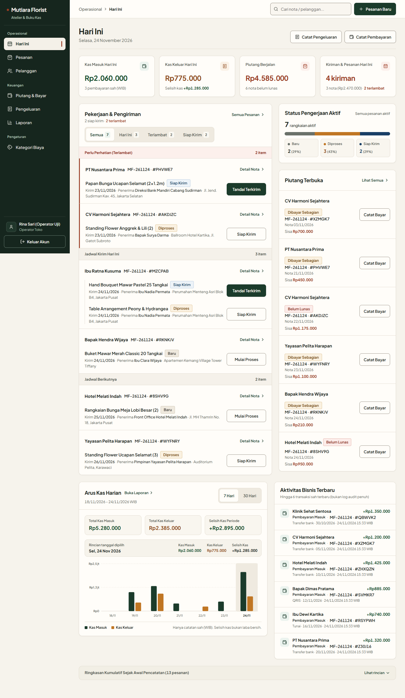
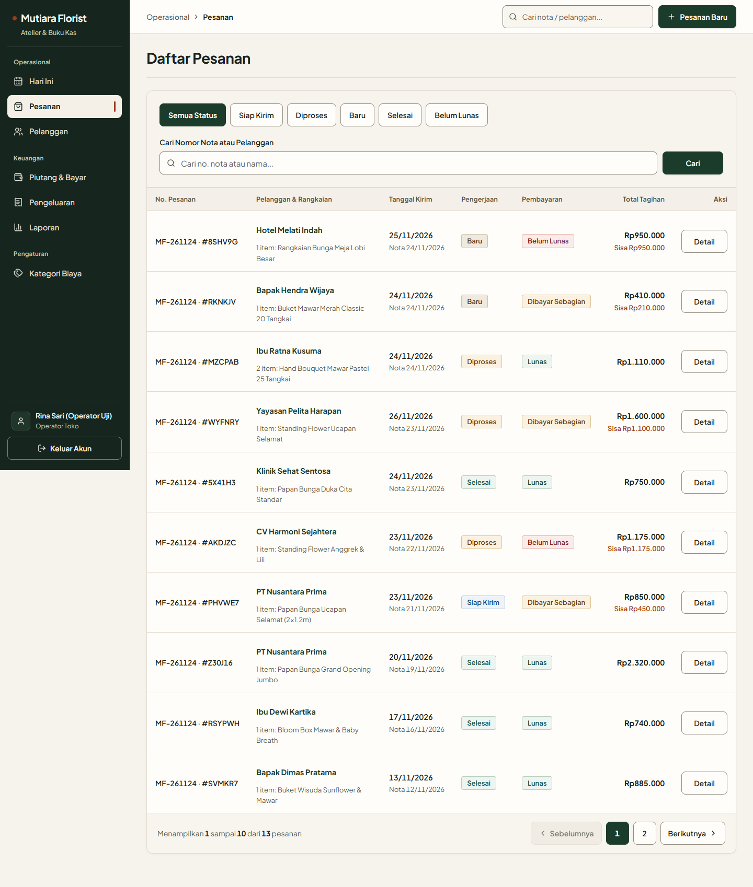
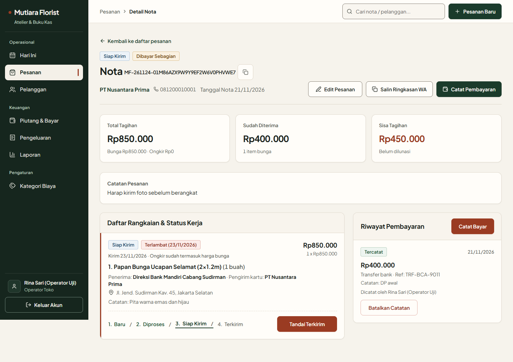
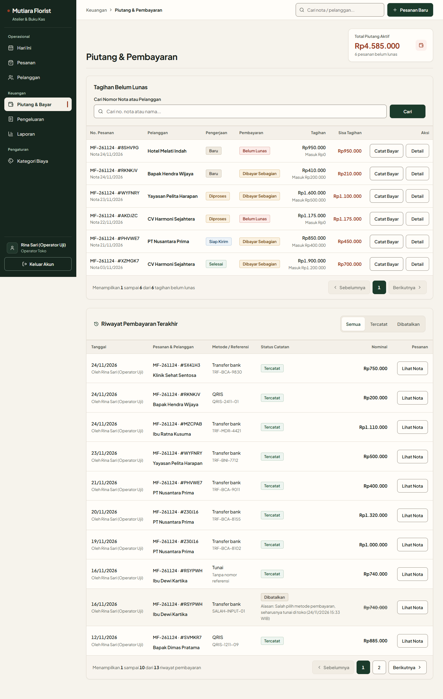
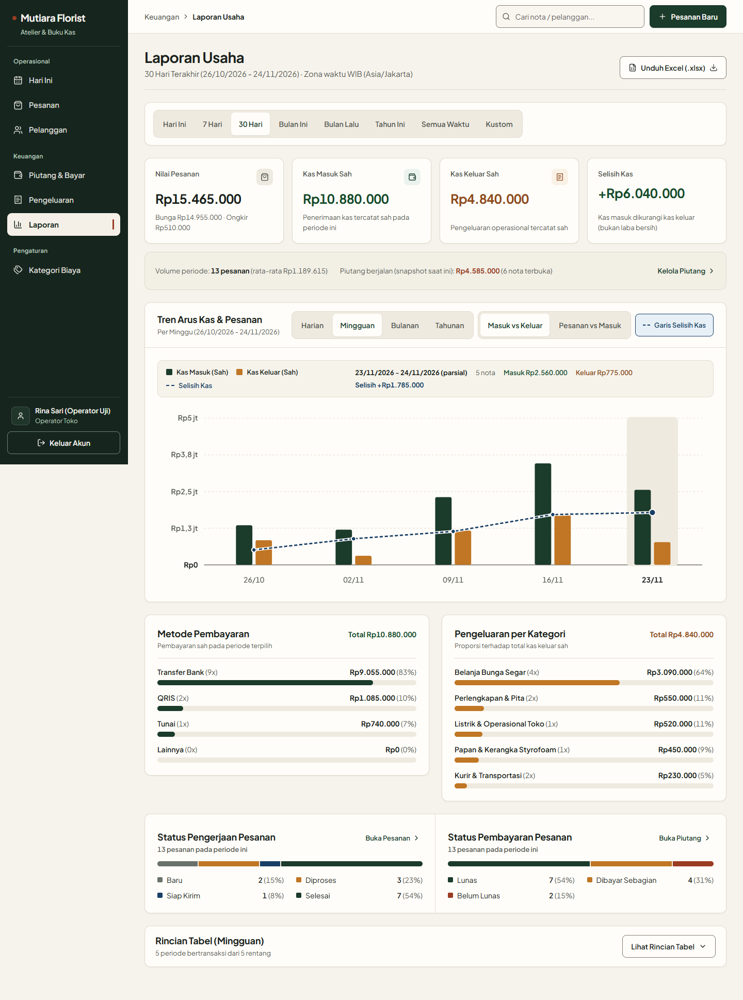

# Mutiara Florist Management System (MFMS)

Aplikasi web administrasi internal untuk operasional **Mutiara Indah Florist**. MFMS memusatkan pencatatan pelanggan, pesanan karangan bunga multi-item, jadwal pengiriman, penerimaan pembayaran dan piutang, pengeluaran operasional, serta pelaporan keuangan dalam satu sistem terpadu.

- **Aplikasi Produksi:** [https://admin.mutiaraflorist.id](https://admin.mutiaraflorist.id) *(dilindungi Cloudflare Zero Trust Access & autentikasi admin)*
- **Desain UI/UX (Figma):** [MFMS Design System & UI (Phase 13)](https://www.figma.com/design/tgjOozJg6XHMossb5IK4px)
- **Baseline Rilis Produksi:** Branch `release/phase13-ui-bi`, commit aplikasi terpasang `0b436a9bc8e53328f633ee21a0666eaa6b3cbe6d`
- **Catatan Versi Repository:** Commit aplikasi produksi yang aktif berjalan di server tetap berada pada `0b436a9bc8e53328f633ee21a0666eaa6b3cbe6d`. Revisi repositori setelah commit tersebut mencakup penataan dokumentasi, penyegaran README, kebersihan berkas repositori, serta perbaikan hygiene konfigurasi database uji lokal dan fixture pengujian tanpa mengubah logika bisnis, perilaku runtime produksi, migrasi database, maupun dependensi aplikasi.

---

## Ringkasan Masalah & Tujuan

Sebelumnya, pencatatan pesanan dan arus kas toko dilakukan secara manual menggunakan lembar kerja terpisah per bulan. Pola tersebut menyulitkan pelacakan:

1. Satu pesanan pelanggan dengan beberapa rangkaian bunga yang memiliki tanggal kirim, tujuan pengiriman, dan kebijakan ongkir berbeda.
2. Pemisahan antara progres pengerjaan bunga (yang sudah terkirim) dan status pelunasan (belum bayar, DP opsional, atau lunas belakangan).
3. Pemisahan antara nilai penjualan (berdasarkan tanggal pesanan) dan arus kas aktual (berdasarkan tanggal pembayaran dan pengeluaran yang sah).
4. Koreksi kesalahan pencatatan tanpa menghapus riwayat transaksi dan tanpa merusak perhitungan piutang berjalan.

MFMS menyelesaikan kebutuhan tersebut dengan perhitungan total di sisi server memakai integer Rupiah (`BIGINT`), penguncian baris transaksi (`lockForUpdate`), kunci idempotensi UUID, serta pencatatan koreksi `VOIDED` yang diaudit.

---

## Fitur Utama

1. **Autentikasi Admin:** Login berbasis sesi Laravel tanpa pendaftaran publik, dilindungi CSRF, rate limiting (`throttle:6,1`), dan middleware verifikasi JWT Cloudflare Access untuk produksi.
2. **Dashboard & Intelijen Operasional:** 4 kartu KPI utama (Kas Masuk Hari Ini, Kas Keluar Hari Ini, Piutang Berjalan, Kiriman & Pesanan Hari Ini), grafik arus kas dengan pilihan rentang 7 hari dan 30 hari, alur pengerjaan pesanan (*pipeline*), antrean pengiriman operasional, ringkasan piutang per nota, serta aktivitas bisnis terbaru.
3. **Manajemen Pelanggan:** Pencarian nama/telepon yang tidak peka huruf besar/kecil, tambah/ubah pelanggan, detail riwayat pesanan pelanggan, serta pengarsipan aman (*soft delete*) khusus pelanggan tanpa transaksi pesanan.
4. **Manajemen Pesanan Multi-Item:** Satu pesanan memuat 1 hingga 20 item bunga dengan penerima, pengirim ucapan, tanggal kirim, lokasi pengiriman, serta mode ongkir per item (`INCLUDED` atau `SEPARATE` yang dihitung sekali per item). Status pengerjaan tiap item bergerak linier (`Baru` -> `Diproses` -> `Siap Kirim` -> `Terkirim`) dan meringkas status pesanan secara otomatis.
5. **Pembayaran & Piutang:** Pencatatan pembayaran fleksibel (tanpa DP, DP opsional, cicilan, atau lunas penuh), daftar piutang berjalan, perlindungan anti-overpayment berbasis `lockForUpdate`, kunci idempotensi UUID, serta pembatalan catatan salah (`VOIDED`) beralasan minimal 10 karakter.
6. **Kategori Biaya & Pengeluaran:** Pengelolaan kategori aktif/nonaktif tanpa menghapus riwayat, pencatatan pengeluaran kas operasional ber-UUID, pencarian serta filter periode/kategori/status, dan koreksi `VOIDED`.
7. **Laporan Keuangan & Ekspor Excel:** Filter periode preset (termasuk opsi **Semua Waktu** dan rentang kustom), kartu KPI keuangan, grafik kas masuk vs kas keluar dengan garis arus kas bersih, rincian metode pembayaran, rincian kategori pengeluaran, tabel rincian transaksi, serta ekspor Excel (`.xlsx`) OpenXML multi-sheet bebas *formula injection*.
8. **Audit Trail & Backup Terenkripsi (Backend/CLI):** Pencatatan aksi kritis di tabel `audit_logs` serta perintah Artisan `mfms:backup` dan `mfms:restore-test` memakai enkripsi AES-256-GCM + AAD, checksum SHA-256, snapshot konsisten `REPEATABLE READ`, dan sinkronisasi sequence PostgreSQL.

---

## Tangkapan Layar Aplikasi (Data Sintetis QA)

Seluruh tangkapan layar di bawah ini diambil langsung dari build Phase 13 pada resolusi desktop `1440px` menggunakan data pengujian sintetis (tanpa data pelanggan atau keuangan asli toko).

### Dashboard & Arus Kas Operasional


### Daftar Pesanan & Detail Pesanan Multi-Item




### Piutang & Pembayaran


### Laporan Keuangan & Analitik Kas


---

## Stack Teknologi

| Lapisan | Implementasi |
| --- | --- |
| Backend | Laravel 12 (`^12.0`), PHP 8.3 pada runtime produksi Docker (`^8.2` pada `composer.json`) |
| Frontend | React 19, TypeScript 5.9, Inertia.js 3 (`@inertiajs/react`), Vite 8 |
| Styling & Desain | Tailwind CSS 4, *Calm Botanical Workspace V2*, Lucide React, `@fontsource-variable/plus-jakarta-sans`, `@fontsource-variable/jetbrains-mono`, grafik SVG kustom |
| Database | PostgreSQL (Supabase pada produksi; teruji paritas pada PostgreSQL 17/18, MariaDB 10.11, dan SQLite `:memory:` untuk PHPUnit) |
| Ekspor Spreadsheet | `App\Support\SimpleXlsxExporter` (OpenXML `.xlsx` native tanpa ketergantungan layanan eksternal) |
| Deployment & Jaringan | Multi-stage Docker (Node 20 + Composer 2.7 + PHP 8.3 FPM + Nginx + Supervisord) di Ubuntu Server, Cloudflare Tunnel, Cloudflare Zero Trust Access |

---

## Arsitektur Aplikasi

MFMS dibangun sebagai aplikasi monolitik full-stack menggunakan Laravel 12 dan Inertia.js 3 sehingga frontend React berkomunikasi melalui rute stateful Laravel dengan proteksi cookie sesi (`HttpOnly`, `SameSite=Lax`, `Secure`) dan CSRF tanpa memerlukan REST API token terpisah.

```text
[Browser Admin]
      | HTTPS (admin.mutiaraflorist.id)
      v
[Cloudflare Edge + Zero Trust Access]
      | Outbound Cloudflare Tunnel
      v
[Ubuntu Server: Docker Container (Nginx + PHP 8.3 FPM + Supervisord)]
      | Laravel 12 + Middleware (VerifyCloudflareAccessJwt, Auth, CSRF)
      | Controllers (Inertia React) -> Domain Services -> Eloquent ORM
      v
[Supabase PostgreSQL (TLS + RLS aktif, PostgREST Data API dicabut)]
```

Penjelasan arsitektur lebih rinci tersedia pada [docs/ARCHITECTURE.md](docs/ARCHITECTURE.md) dan skema relasi 8 tabel bisnis pada [docs/DATABASE.md](docs/DATABASE.md).

---

## Instalasi Lokal

### Prasyarat

- PHP `8.2` atau `8.3` dengan ekstensi `pdo_pgsql` dan/atau `pdo_mysql`, `pdo_sqlite`, `mbstring`, `openssl`, `zip`, `bcmath`, `fileinfo`
- Composer `2.x`
- Node.js `20+` dan `npm`
- PostgreSQL `16+` (disarankan agar sesuai produksi) atau MariaDB/MySQL lokal

### Langkah Cepat

```bash
# 1. Clone repositori
git clone --branch release/phase13-ui-bi --single-branch https://github.com/Vluuuu/Mutiara-Florist-Management-System.git
cd Mutiara-Florist-Management-System

# 2. Pasang dependensi backend dan frontend
composer install
npm install

# 3. Salin konfigurasi lingkungan dan buat APP_KEY
cp .env.example .env
php artisan key:generate

# 4. Sesuaikan kredensial database lokal pada .env, lalu jalankan migrasi
php artisan migrate

# 5. Buat akun admin pertama (interaktif melalui CLI)
php artisan mfms:create-admin

# 6. Build aset frontend dan jalankan server lokal
npm run build
php artisan serve --host=127.0.0.1 --port=8000
```

Untuk mode pengembangan dengan *Hot Module Replacement*, jalankan `npm run dev` di terminal terpisah bersamaan dengan `php artisan serve`. Panduan instalasi lengkap tersedia di [docs/LOCAL_SETUP.md](docs/LOCAL_SETUP.md).

---

## Konfigurasi Database

- **Produksi (PostgreSQL / Supabase):** Atur `DB_CONNECTION=pgsql`, `DB_SSLMODE=require`, serta kredensial pooler/direct PostgreSQL pada environment server. Aktifkan Row Level Security (RLS) pada seluruh tabel skema `public` dan cabut hak akses role `anon`/`authenticated` agar tabel tidak terekspos lewat PostgREST.
- **Pengembangan Lokal:** Mendukung PostgreSQL lokal (`DB_CONNECTION=pgsql`) maupun MariaDB/MySQL lokal (`DB_CONNECTION=mysql`). Pencarian teks secara otomatis menyesuaikan operator `ILIKE` (PostgreSQL) atau `LIKE` (MariaDB/SQLite).
- **Pengujian Otomatis:** File `phpunit.xml` secara eksplisit memaksa `DB_CONNECTION=sqlite` dan `DB_DATABASE=:memory:` sehingga menjalankan test suite tidak pernah mengubah database lokal atau produksi pada `.env`.

---

## Pengujian

Berdasarkan bukti regresi penuh rilis Phase 13 pada [docs/phase13/PHASE13E_FULL_REGRESSION_AND_RELEASE_READINESS_REPORT.md](docs/phase13/PHASE13E_FULL_REGRESSION_AND_RELEASE_READINESS_REPORT.md), seluruh **236 pengujian otomatis** lulus (*0 fail, 0 error*) lintas SQLite, PostgreSQL 17, dan MariaDB 10.11.

Untuk menjalankan verifikasi lokal secara terisolasi:

```bash
# Pengujian otomatis backend & fitur (SQLite in-memory via phpunit.xml)
php artisan test

# Pemeriksaan tipe TypeScript
npm run typecheck

# Verifikasi build produksi Vite
npm run build
```

Rincian skenario penerimaan T-01 sampai T-38 dan cakupan modul uji dapat dilihat di [docs/TEST_PLAN.md](docs/TEST_PLAN.md).

---

## Ringkasan Deployment

Produksi MFMS berjalan pada server **Ubuntu** menggunakan multi-stage `Dockerfile` (`node:20-alpine` -> `composer:2.7` -> `php:8.3-fpm-alpine` dengan Nginx dan Supervisord) yang terhubung ke **Supabase PostgreSQL** dan dipublikasikan melalui **Cloudflare Tunnel** ke `https://admin.mutiaraflorist.id` tanpa membuka port publik langsung pada firewall/router.

Container tidak menjalankan migrasi database secara otomatis saat startup (`docker/entrypoint.sh`) demi mencegah mutasi skema tak terduga. Panduan lengkap deployment dan variabel lingkungan tersedia di [docs/DEPLOYMENT.md](docs/DEPLOYMENT.md).

---

## Keamanan & Pengelolaan Data

- **Pemisahan Data Publik vs Operasional:** Repository publik tidak menyimpan file `.env`, kredensial, kunci enkripsi, dump SQL, arsip backup `.enc`/`.meta.json`, data pelanggan nyata, maupun catatan keuangan operasional. Seluruh data contoh dan tangkapan layar memakai data sintetis.
- **Integritas Transaksi Keuangan:** Nominal Rupiah bulat `BIGINT` dihitung server; penguncian `lockForUpdate` mencegah pembayaran berlebih konkuren; kunci idempotensi UUID mencegah duplikasi; koreksi transaksi menggunakan status `VOIDED` beralasan dan terekam di `audit_logs`.
- **Proteksi Akses Berlapis:** Cloudflare Zero Trust Access (verifikasi JWT RS256 fail-closed pada `VerifyCloudflareAccessJwt`), autentikasi sesi Laravel, CSRF, rate limiting login, serta pemblokiran akses file sensitif pada konfigurasi Nginx.
- **Backup Terenkripsi:** Pencadangan mandiri menggunakan `php artisan mfms:backup` dengan AES-256-GCM + AAD, SHA-256 checksum, dan verifikasi uji restorasi `mfms:restore-test` yang dilindungi agar tidak dapat menarget database operasional. Lihat [docs/BACKUP_RESTORE.md](docs/BACKUP_RESTORE.md).

---

## Keterbatasan Saat Ini

1. **Single Admin Role:** Belum terdapat pembagian peran bertingkat (RBAC); seluruh akun admin yang terautentikasi memiliki hak akses penuh.
2. **Tanpa Pembatalan/Refund Order, Diskon, dan Pajak:** Fitur `CANCELLED`, pengembalian dana (*refund*), potongan harga, dan pajak secara sengaja berada di luar lingkup rilis sesuai keputusan bisnis di [docs/BUSINESS_RULES.md](docs/BUSINESS_RULES.md).
3. **Audit Log & Backup Berbasis Backend/CLI:** Mekanisme `audit_logs` dan backup/restore terenkripsi berjalan di sisi backend dan perintah Artisan; belum tersedia halaman antarmuka web khusus untuk keduanya.
4. **Pembuatan Order & Pembayaran Dua Langkah:** Pencatatan pembayaran dilakukan setelah pesanan tersimpan (dari halaman detail pesanan atau daftar piutang), belum digabung dalam satu transaksi submit pembuatan order.
5. **Laporan Arus Kas Sederhana:** Selisih kas masuk dikurangi kas keluar merupakan ringkasan arus kas operasional, bukan laporan laba/rugi akuntansi *double-entry*, dan piutang yang ditampilkan bersifat snapshot berjalan saat laporan dibuka.

---

## Dokumentasi

Indeks lengkap dokumentasi aktif, bukti QA Phase 13, dan arsip historis pengembangan tersedia di [docs/README.md](docs/README.md). Dokumen utama:

- [docs/ARCHITECTURE.md](docs/ARCHITECTURE.md)
- [docs/DATABASE.md](docs/DATABASE.md)
- [docs/BUSINESS_RULES.md](docs/BUSINESS_RULES.md)
- [docs/PRICING_AND_SHIPPING.md](docs/PRICING_AND_SHIPPING.md)
- [docs/DESIGN.md](docs/DESIGN.md)
- [docs/LOCAL_SETUP.md](docs/LOCAL_SETUP.md)
- [docs/DEPLOYMENT.md](docs/DEPLOYMENT.md)
- [docs/HANDOVER_OPERATOR_GUIDE.md](docs/HANDOVER_OPERATOR_GUIDE.md)
- [docs/TEST_PLAN.md](docs/TEST_PLAN.md)
- [docs/BACKUP_RESTORE.md](docs/BACKUP_RESTORE.md)
