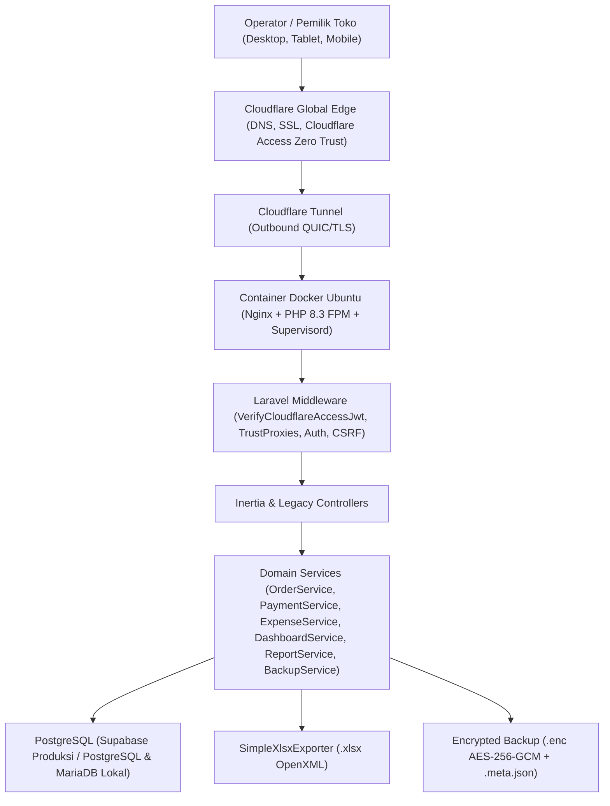

# Arsitektur Sistem MFMS

**Versi Dokumen:** Phase 13 (`release/phase13-ui-bi`, baseline rilis `0b436a9`)

## 1. Ringkasan Arsitektur

Mutiara Florist Management System (MFMS) adalah aplikasi web monolitik modern berbasis **Laravel 12** (PHP 8.3 pada runtime produksi Docker; syarat minimum PHP `^8.2`) dan **React 19 + TypeScript + Inertia.js 3 + Tailwind CSS 4**. Aplikasi melayani operasional administrasi internal toko bunga secara terpusat di [https://admin.mutiaraflorist.id](https://admin.mutiaraflorist.id) tanpa memisahkan backend menjadi microservice atau REST API publik.



## 2. Stack Teknologi Terpasang

| Lapisan | Teknologi | Peran |
| --- | --- | --- |
| Backend Framework | Laravel 12 (`laravel/framework ^12.0`) | Routing, autentikasi sesi, validasi FormRequest, Eloquent ORM, transaksi ACID, CLI Artisan. |
| Runtime PHP | PHP 8.3 (Docker Alpine) / PHP `^8.2` lokal | Menjalankan PHP-FPM, ekstensi `pdo_pgsql`, `pdo_mysql`, `zip`, `bcmath`, `opcache`. |
| Frontend & SPA Bridge | React 19, TypeScript 5.9, Inertia.js 3 (`@inertiajs/react`) | Antarmuka halaman responsif dengan navigasi SPA stateful tanpa REST API token terpisah. |
| Styling & Desain | Tailwind CSS 4, Vite 8, `lucide-react`, `@fontsource-variable/plus-jakarta-sans`, `@fontsource-variable/jetbrains-mono` | Sistem desain *Calm Botanical Workspace V2* dengan font dibundel lokal agar bebas ketergantungan CDN eksternal. |
| Visualisasi Data | Komponen SVG kustom berbasis React | Grafik arus kas 7/30 hari, tren kas masuk/keluar/bersih, dan ringkasan distribusi pada Dashboard dan Laporan tanpa library charting pihak ketiga. |
| Database | PostgreSQL (Supabase di produksi; PostgreSQL 17/18 & MariaDB 10.11 teruji paritas; SQLite `:memory:` untuk PHPUnit) | Penyimpanan relasional 8 tabel bisnis + tabel framework Laravel. |
| Ekspor Laporan | `App\Support\SimpleXlsxExporter` | Menghasilkan berkas Excel `.xlsx` OpenXML multi-sheet dengan sel numerik murni dan mitigasi formula injection. |
| Infrastruktur Produksi | Docker (`Dockerfile`, `docker/`), Ubuntu Server, Cloudflare Tunnel | Kontainerisasi Nginx + PHP-FPM + Supervisord tanpa membuka port publik langsung pada router/firewall. |

## 3. Struktur Lapisan Aplikasi

```text
app/
├── Console/Commands/       # Perintah Artisan (create-admin, backup, restore-test, migrate-staging, seed-staging)
├── Http/
│   ├── Controllers/        # Ui*Controller (Inertia React utama) & controller Blade legacy untuk fallback
│   ├── Middleware/         # HandleInertiaRequests, VerifyCloudflareAccessJwt
│   └── Requests/           # Validasi input ketat (FormRequest) pada sisi server
├── Models/                 # User, Customer, Order, OrderItem, Payment, ExpenseCategory, Expense, AuditLog
├── Services/               # Logika transaksi bisnis, kalkulasi total, dashboard BI, laporan, & backup AES-256-GCM
└── Support/                # SimpleXlsxExporter, DatabaseTargetGuard, helper portabilitas query

resources/
├── css/app.css             # Token desain Calm Botanical Workspace V2 & aturan Tailwind CSS 4
└── js/
    ├── components/         # AppLayout, AppSidebar, form pesanan, komponen tabel/modal/badge/grafik SVG
    └── pages/              # Auth/Login, Dashboard, Customers/*, Orders/*, Payments/Index, Expenses/*, ExpenseCategories/Index, Reports/Index
```

## 4. Rute Utama Aplikasi

Seluruh rute aplikasi bisnis berada di balik middleware autentikasi `auth` (kecuali `/login` dan probe `/up`):

- **Autentikasi:** `/login` (Inertia React), `/logout` (POST)
- **Dashboard & BI Operasional:** `/dashboard` (juga dapat diakses melalui `/ui-dashboard`)
- **Manajemen Pelanggan:** `/ui-customers` (`index`, `create`, `store`, `show`, `edit`, `update`, `destroy` soft-delete)
- **Manajemen Pesanan:** `/ui-orders` (`index`, `create`, `store`, `show`, `edit`, `update`, `POST /ui-orders/{order}/items/{item}/status`)
- **Pembayaran & Piutang:** `/ui-payments`, `POST /ui-orders/{order}/payments`, `POST /ui-orders/{order}/payments/{payment}/void`
- **Pengeluaran & Kategori Biaya:** `/ui-expenses`, `/ui-expenses/create`, `POST /ui-expenses/{expense}/void`, `/ui-expense-categories`
- **Laporan Keuangan & Ekspor:** `/ui-reports`, `/ui-reports/export`

Catatan: rute Blade lama (`/legacy/dashboard`, `/customers`, `/orders`, `/payments`, `/expenses`, `/expense-categories`) masih dipertahankan di `routes/web.php` sebagai jalur fallback kompatibilitas dan dicakup oleh regression test, namun seluruh navigasi pengguna memakai antarmuka React/Inertia.

## 5. Keamanan dan Integritas Transaksi

1. **Pertahanan Berlapis (Defense-in-Depth):**
   - Lapisan tepi menggunakan Cloudflare Tunnel dan Cloudflare Zero Trust Access.
   - Middleware `VerifyCloudflareAccessJwt` memverifikasi token JWT RS256 (`Cf-Access-Jwt-Assertion`) dengan perilaku *fail-closed* saat enforcement diaktifkan di produksi, serta mendukung header `X-MFMS-Edge-Secret` opsional.
   - Lapisan aplikasi menerapkan login sesi Laravel (`HttpOnly`, `SameSite=Lax`, `Secure` pada HTTPS), proteksi CSRF, dan rate limiting login (`throttle:6,1`).
   - Tidak ada pendaftaran akun publik; pembuatan admin awal dilakukan melalui CLI `php artisan mfms:create-admin`.
2. **Integritas Keuangan & Konkurensi:**
   - Semua nominal memakai integer Rupiah (`BIGINT`) dan dihitung di server.
   - Perubahan pesanan dan pencatatan pembayaran menggunakan transaksi database serta penguncian baris (`SELECT ... FOR UPDATE` / `lockForUpdate()`) pada baris `orders` untuk mencegah pembayaran berlebih akibat request paralel.
   - Kunci idempotensi UUID unik pada `payments` dan `expenses` mencegah pencatatan ganda akibat klik ulang atau retry jaringan.
   - Koreksi transaksi kas memakai status `VOIDED` beralasan (minimal 10 karakter) dan tercatat di `audit_logs`, tanpa penghapusan fisik.
3. **Portabilitas Database Lintas Mesin:**
   - Pencarian teks memakai operator portabel (`ILIKE` di PostgreSQL, `LIKE` di MariaDB/SQLite) dengan literal escaping `%` dan `_`.
   - `BackupService` mendukung snapshot konsisten `REPEATABLE READ` pada PostgreSQL maupun MariaDB, restorasi berurutan topologis, serta sinkronisasi sequence `setval` PostgreSQL.

## 6. Keterbatasan Arsitektur Saat Ini

- **Single Admin Role:** Belum terdapat sistem peran bertingkat (RBAC); semua akun yang terautentikasi memiliki hak akses penuh yang sama.
- **Belum Ada UI Audit Log & Backup:** Pencatatan `audit_logs` dan backup/restore terenkripsi berjalan di sisi backend dan CLI Artisan, belum memiliki halaman antarmuka khusus.
- **Tanpa Fitur Cancel/Refund, Diskon, dan Pajak:** Sengaja berada di luar lingkup rilis saat ini sesuai kesepakatan aturan bisnis di [BUSINESS_RULES.md](BUSINESS_RULES.md).

Rujukan terkait: [DATABASE.md](DATABASE.md), [DEPLOYMENT.md](DEPLOYMENT.md), [DESIGN.md](DESIGN.md).
