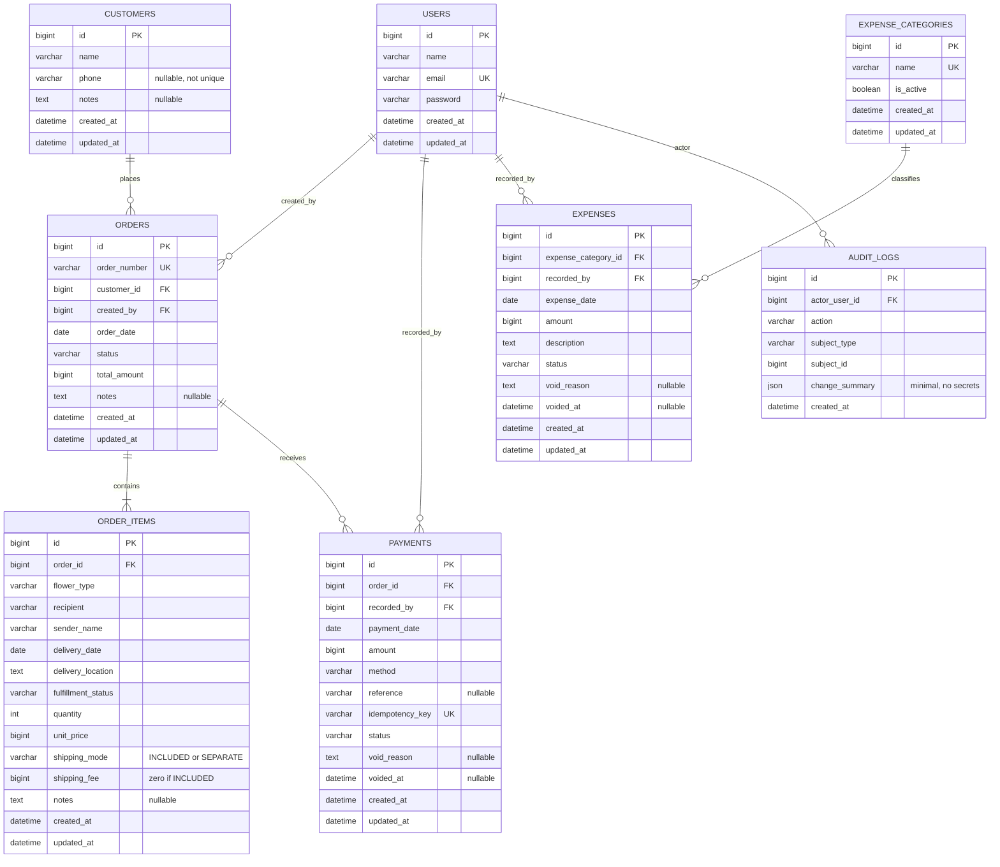

# Database Design & ERD — MFMS

**Versi rancangan:** v0.4 (2 November 2026) — ongkir INCLUDED/SEPARATE per item  
**Status:** Core schema siap menjadi acuan implementasi setelah keputusan bisnis terbuka disahkan. **Belum ada migration ataupun data nyata di repo.**

## 1. Konteks dan prinsip

- **Database:** MySQL lokal, Laravel migrations + Eloquent ORM.
- **Grain:** satu pelanggan memiliki banyak pesanan; satu pesanan memiliki satu atau banyak item bunga; **setiap item memiliki tanggal, lokasi pengiriman, serta mode dan biaya ongkir sendiri**; satu pesanan memiliki nol atau banyak transaksi pembayaran.
- **Nominal:** semua uang disimpan dalam **Rupiah bulat** memakai BIGINT non-negatif. Dilarang menggunakan FLOAT/DOUBLE untuk nominal uang. Validasi batas perkalian untuk mencegah overflow.
- **Tanggal:** `orders.order_date` adalah tanggal transaksi; `order_items.delivery_date` adalah tanggal kirim tiap rangkaian; `payments.payment_date` dan `expenses.expense_date` adalah tanggal arus kas. Timezone aplikasi Asia/Jakarta. Simpan `created_at` dan `updated_at` untuk jejak sistem.
- **Status pesanan** dan **status bayar** terpisah. Status bayar dihitung dari nilai tagihan dan pembayaran POSTED, bukan dua checkbox.
- **Delete:** jangan menghapus permanen pesanan yang memiliki riwayat pembayaran; jangan menghapus permanen pembayaran atau pengeluaran. Void/koreksi wajib memiliki alasan dan jejak audit.
- **Data contoh:** seed sintetis saja, tidak memasukkan identitas asli pelanggan ke repository.

## 2. ERD



**Catatan:** relasi ORDERS–ORDER_ITEMS wajib memiliki minimal satu item pada saat order dinyatakan tersimpan; syarat jumlah minimal 1 ditegakkan di service/transaction, bukan oleh FK semata. Relasi actor audit bersifat internal dan perlu kebijakan jika akun user dinonaktifkan.

## 3. Tabel final untuk core flow

| Tabel | Fungsi | Kunci dan aturan |
| --- | --- | --- |
| `users` | Operator login | email unik; password di-hash |
| `customers` | Data nama/kontak pemesan | telepon boleh kosong dan tidak diasumsikan unik |
| `orders` | Header pesanan dan ringkasan status pengerjaan | order_number unik; customer_id wajib; total_amount dihitung backend; **tidak mempunyai tanggal kirim tunggal** |
| `order_items` | Rangkaian bunga dan pengiriman masing-masing | quantity > 0; unit_price >= 0; **delivery_date, delivery_location, shipping_mode dan shipping_fee per item**; pengirim/penerima dan fulfillment_status per item |
| `payments` | Riwayat penerimaan DP/pelunasan | amount > 0; POSTED/VOIDED; idempotency_key unik per submit |
| `expense_categories` | Kelompok biaya | nama unik; nonaktifkan alih-alih hapus jika sudah dipakai |
| `expenses` | Pengeluaran kas usaha | amount > 0; POSTED/VOIDED; category FK |
| `audit_logs` | Riwayat aksi kritis | append-only, actor dan waktu; tidak simpan password atau data sensitif berlebihan |

Model awal menggunakan **8 tabel bisnis/pendukung** (di luar tabel framework Laravel seperti sessions/cache/jobs jika dibuat). Belum memerlukan `products`, `invoices`, `refunds`, ataupun `attachments` karena aturan atau kebutuhan detailnya belum disepakati.

## 4. Enumerasi yang disarankan

- `order_items.fulfillment_status`: `NEW` → `PROCESSING` → `READY` → `DELIVERED`. Tidak ada pembatalan parsial item pada MVP sebelum aturan refund/pembayaran disepakati.
- `orders.status`: ringkasan turunan dari status item (`NEW` jika semua NEW; `READY` jika semua READY; `COMPLETED` jika semua DELIVERED; selain itu `PROCESSING`), dapat dimaterialisasi dan dihitung ulang atomik. `CANCELLED` hanya pembatalan **seluruh order tanpa pembayaran** pada MVP, dengan alasan pada audit. Jangan menandai order selesai bila baru sebagian item DELIVERED.
- `payments.status` dan `expenses.status`: `POSTED` / `VOIDED`.
- **Payment status** bukan field input/tabel terpisah: `UNPAID`, `PARTIAL`, `PAID` dihitung, dengan status khusus `CANCELLED` ditampilkan terpisah bila order dibatalkan.

Pada tahap pertama, perubahan dari COMPLETED/CANCELLED kembali menjadi aktif serta pembatalan order dengan pembayaran POSTED **tidak diizinkan** sampai aturan refund disepakati.

## 5. Sumber kebenaran dan konsistensi total

```text
product_subtotal(item) = quantity * unit_price
shipping_charge(item)  = 0 jika INCLUDED; shipping_fee jika SEPARATE
item_billable_total    = product_subtotal(item) + shipping_charge(item)
orders.total_amount    = SUM(item_billable_total)    (materialisasi, hanya backend yang menulis)
paid_amount       = SUM(payments.amount WHERE status='POSTED' AND order_id = ?)
outstanding       = orders.total_amount - paid_amount
payment_status    = UNPAID jika paid_amount = 0 dan total > 0
                    PARTIAL jika 0 < paid_amount < total
                    PAID jika paid_amount = total dan total > 0
```

- Pesanan baru harus memiliki total > 0 pada MVP. Pesanan gratis/kompensasi perlu aturan tersendiri.
- `shipping_mode` wajib `INCLUDED` atau `SEPARATE`; `shipping_fee` bernilai **0 untuk INCLUDED** dan **> 0 untuk SEPARATE**. Ongkir adalah **sekali per baris pengiriman**, tidak dikalikan quantity. Per baris item memiliki satu tanggal/lokasi; beda tanggal/lokasi berarti item berbeda.
- `shipping_fee` adalah ongkir **yang ditagihkan kepada pelanggan** (bukan ongkos aktual yang dibayarkan florist kepada kurir). Ongkos aktual yang dibayar dicatat tersendiri di `expenses` jika ada.
- Untuk `INCLUDED`, ongkir diasumsikan sudah terserap dalam harga produk yang dimasukkan operator. Jangan menambah ongkir kedua kali.
- Mode campuran diizinkan dalam satu order karena tanggal/tujuan kirim dapat berbeda.
- `orders.total_amount` dan item (termasuk ongkir) diperbarui dalam **satu database transaction**. Perubahan total setelah ada pembayaran dibatasi: jangan izinkan total baru < sudah dibayar. Perubahan nominal penting harus masuk audit.
- Validasi pembayaran dilakukan di transaction yang mengunci baris order (`SELECT ... FOR UPDATE` melalui Eloquent `lockForUpdate`), supaya dua submit simultan tidak melebihi tagihan. Unik `idempotency_key` membatasi pengulangan satu aksi; bukan melarang dua pembayaran sah dengan jumlah sama.
- DB index: `orders(order_date, status)`, `orders(customer_id)`, **`order_items(delivery_date, fulfillment_status)`**, `payments(order_id, payment_date, status)`, `expenses(expense_date, status)`. FK dan indeks ditentukan secara konsisten di migration.

## 6. Batas definisi laporan

| Metrik | Sumber | Basis tanggal |
| --- | --- | --- |
| Total nilai pesanan aktif (termasuk ongkir tambahan) | SUM total_amount orders non-CANCELLED | order_date |
| Nilai bunga tercatat | SUM(quantity * unit_price) item dari orders non-CANCELLED | order_date |
| Ongkir ditagihkan | SUM(shipping_fee) item SEPARATE dari orders non-CANCELLED | order_date |
| Uang masuk | SUM payments POSTED | payment_date |
| Uang keluar | SUM expenses POSTED | expense_date |
| Selisih arus kas sederhana | uang masuk - uang keluar | periode pembayaran/pengeluaran |
| Piutang saat ini | SUM outstanding dari orders non-CANCELLED | **snapshot saat laporan dibuka**, bukan otomatis piutang historis akhir bulan |

Angka penjualan di sini adalah nilai order tercatat, **bukan laporan laba/rugi akuntansi**. Void/koreksi mengubah tampilan laporan periode asal; jejak pembetulannya harus tersedia di audit log. Bila membutuhkan laporan historis *as-of*, diperlukan ledger/snapshot terpisah dan keputusan produk baru.

## 7. Migrasi dan strategi pengembangan

1. Siapkan migration users (bawaan auth), customers, orders, order_items, payments, expense_categories, expenses, audit_logs.
2. Foreign key memakai pembatasan yang melindungi riwayat; jangan cascade delete untuk data finansial.
3. Gunakan Laravel FormRequest dan layanan khusus untuk membuat order, mencatat pembayaran, dan melakukan void.
4. Seed hanya contoh sintetis; uji fresh migrate, transaksi atomik, hubungan antar tabel, dan indeks.

## 8. Keputusan bisnis belum final (jangan asumsi)

- **Telah dikonfirmasi operator:** satu order bisa berisi beberapa item dengan tanggal dan lokasi kirim berbeda. `delivery_date` dan `delivery_location` disimpan pada setiap `order_items`. Bila satu jenis bunga yang sama dikirim ke tanggal/lokasi berbeda, catat sebagai **item terpisah**.
- Waktu kirim spesifik (jam), jasa kurir, dan bukti serah terima belum menjadi scope MVP; dapat ditambahkan nanti.
- **Ongkir telah disepakati:** tergantung pesanan, bisa sudah termasuk harga bunga atau ditagihkan terpisah. Implementasi menggunakan mode dan biaya ongkir pada **setiap item** supaya beberapa tujuan/tanggal dalam satu pesanan tidak kehilangan rincian. Lihat [PRICING_AND_SHIPPING.md](PRICING_AND_SHIPPING.md).
- **Diskon, pajak dan biaya lainnya belum diputuskan**, sehingga belum termasuk rumus.
- Pengembalian DP, biaya pembatalan, refund, serta void yang melibatkan dana nyata membutuhkan kebijakan terpisah.
- Koreksi pembayaran yang salah input boleh di-void dengan alasan dan audit; **bukan** refund uang yang sudah dikembalikan ke pelanggan.
- Syarat nomor pesanan, metode pembayaran, serta privasi/retensi lampiran belum dipastikan.

Lihat [BUSINESS_RULES.md](BUSINESS_RULES.md), [PRICING_AND_SHIPPING.md](PRICING_AND_SHIPPING.md), [WORKFLOWS.md](WORKFLOWS.md), dan [DECISIONS.md](DECISIONS.md).
