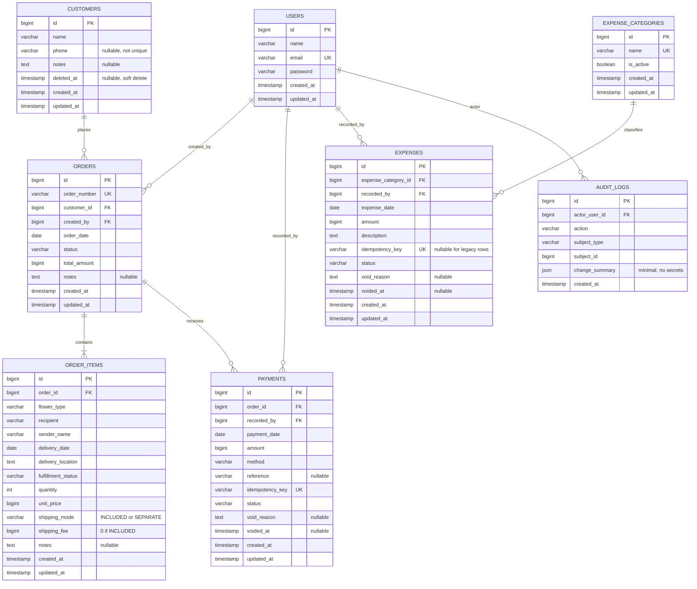

# Desain Database & ERD MFMS

**Versi Dokumen:** Phase 13 (`release/phase13-ui-bi`, baseline rilis `0b436a9`)  
**Status Mesin Database:** Teruji paritas penuh pada **PostgreSQL (Supabase produksi & PG 17/18 lokal)**, **MariaDB 10.11**, dan **SQLite `:memory:`** (PHPUnit).

## 1. Prinsip Desain Data

- **Portabilitas RDBMS:** Migrasi Laravel dan query aplikasi kompatibel lintas PostgreSQL, MariaDB/MySQL, dan SQLite. Pencarian teks menggunakan operator dinamis (`ILIKE` untuk `pgsql`, `LIKE` untuk `mysql`/`sqlite`) dengan literal escaping karakter wildcard.
- **Grain Relasional:** Satu pelanggan memiliki nol atau banyak pesanan; satu pesanan memiliki 1 sampai 20 item bunga; setiap item memiliki `delivery_date`, `delivery_location`, `recipient`, `sender_name`, `fulfillment_status`, `shipping_mode`, dan `shipping_fee` sendiri; satu pesanan memiliki nol atau banyak event pembayaran.
- **Nominal Rupiah Bulat:** Seluruh nilai uang disimpan dalam tipe `BIGINT` non-negatif (Rupiah bulat tanpa desimal). Tipe `FLOAT`/`DOUBLE` dilarang untuk nominal uang.
- **Basis Tanggal Terpisah (`Asia/Jakarta`):**
  - `orders.order_date`: tanggal nota pesanan.
  - `order_items.delivery_date`: tanggal pengiriman per rangkaian bunga.
  - `payments.payment_date` dan `expenses.expense_date`: tanggal arus kas masuk dan keluar.
- **Pemisahan Status Operasional & Pembayaran:** Status pengerjaan (`orders.status` turunan dari `order_items.fulfillment_status`) terpisah dari status pembayaran (`UNPAID`, `PARTIAL`, `PAID` yang dihitung dari `payments` berstatus `POSTED`). Order boleh disimpan tanpa DP atau pembayaran awal, dan order `COMPLETED` tidak otomatis lunas.
- **Integritas Audit & Anti Hard-Delete:** Transaksi keuangan (`payments`, `expenses`) tidak dihapus fisik. Koreksi dilakukan lewat status `VOIDED` beserta `void_reason` dan `voided_at`. Pelanggan hanya boleh diarsipkan (`deleted_at` soft delete) jika belum memiliki pesanan.
- **Privasi Data:** Repository hanya memuat skema migrasi dan data sintetis pengujian. Data pelanggan dan keuangan nyata tidak pernah disimpan di GitHub.

## 2. Entity Relationship Diagram (ERD)



## 3. Ringkasan 8 Tabel Bisnis Inti

Di luar tabel bawaan framework Laravel (`sessions`, `cache`, `jobs`, `migrations`), MFMS memiliki 8 tabel bisnis:

| Tabel | Fungsi | Aturan & Indeks Utama |
| --- | --- | --- |
| `users` | Akun operator/admin | `email` unik, password hash bcrypt. |
| `customers` | Master pelanggan | `name` wajib, `phone` tidak harus unik, arsip menggunakan `deleted_at` (diblokir jika memiliki order). |
| `orders` | Header pesanan | `order_number` unik berbasis ULID (`MF-YYMMDD-<ULID>`), `total_amount` dihitung server, indeks `(order_date, status)` dan `customer_id`. |
| `order_items` | Rangkaian bunga & jadwal pengiriman | `quantity > 0`, `unit_price >= 0`, `shipping_mode` (`INCLUDED`/`SEPARATE`), `shipping_fee` sekali per item, indeks `(delivery_date, fulfillment_status)`. |
| `payments` | Event penerimaan kas | 0..N per order, `amount > 0`, `POSTED`/`VOIDED`, `idempotency_key` UUID unik, indeks `(order_id, payment_date, status)`. |
| `expense_categories` | Kategori pengeluaran operasional | `name` unik, `is_active` boolean (nonaktifkan alih-alih hapus). |
| `expenses` | Catatan pengeluaran kas | `amount > 0`, `POSTED`/`VOIDED`, `idempotency_key` UUID unik nullable, indeks `(expense_date, status)`. |
| `audit_logs` | Jejak audit aksi kritis | Append-only, mencatat aktor, jenis subjek, ID subjek, dan ringkasan perubahan tanpa kredensial/PII sensitif. |

## 4. Enumerasi & Perhitungan Total

- `order_items.fulfillment_status`: `NEW` -> `PROCESSING` -> `READY` -> `DELIVERED` (linier, tidak boleh melompati tahap).
- `orders.status`: ringkasan turunan atomik (`NEW` jika semua `NEW`, `READY` jika semua `READY`, `COMPLETED` jika semua `DELIVERED`, selain itu `PROCESSING`). Tidak ada status `CANCELLED`.
- `payments.status` & `expenses.status`: `POSTED` atau `VOIDED`.
- Status pembayaran turunan: `UNPAID`, `PARTIAL`, `PAID`.

```text
product_subtotal(item) = quantity * unit_price
shipping_charge(item)  = 0 jika INCLUDED; shipping_fee jika SEPARATE
item_billable_total    = product_subtotal(item) + shipping_charge(item)
orders.total_amount    = SUM(item_billable_total)    # ditulis hanya oleh OrderService

paid_amount            = SUM(payments.amount WHERE status = 'POSTED' AND order_id = ?)
outstanding            = max(orders.total_amount - paid_amount, 0)
```

Baik `OrderService::update` maupun `PaymentService::recordPayment` mengunci baris `orders` dengan `lockForUpdate()` dalam transaksi ACID agar total tagihan baru tidak pernah lebih kecil dari total pembayaran `POSTED` dan request pembayaran paralel tidak dapat menyebabkan overpayment.

## 5. Keamanan PostgreSQL di Supabase

Pada lingkungan produksi berbasis Supabase PostgreSQL:

1. Koneksi Laravel menggunakan PDO langsung (SSL wajib `DB_SSLMODE=require`) melalui connection pooler atau direct PostgreSQL, bukan PostgREST HTTP Data API.
2. **Row Level Security (RLS)** diaktifkan pada seluruh tabel di skema `public`, dan hak akses role `anon` serta `authenticated` dicabut (`REVOKE ALL`) sehingga tidak ada data yang dapat diakses melalui endpoint Data API publik Supabase.
3. Setelah restorasi data dengan ID eksplisit pada PostgreSQL, `BackupService` otomatis menyinkronkan sequence primary key (`pg_get_serial_sequence` + `setval`).

## 6. Basis Metrik Laporan

| Metrik | Sumber Data | Basis Tanggal |
| --- | --- | --- |
| Total nilai pesanan | `SUM(orders.total_amount)` | `orders.order_date` |
| Nilai bunga tercatat | `SUM(quantity * unit_price)` | `orders.order_date` |
| Ongkir ditagihkan | `SUM(shipping_fee)` untuk item `SEPARATE` | `orders.order_date` |
| Uang masuk (Kas Masuk) | `SUM(payments.amount)` berstatus `POSTED` | `payments.payment_date` |
| Uang keluar (Kas Keluar) | `SUM(expenses.amount)` berstatus `POSTED` | `expenses.expense_date` |
| Arus kas bersih (Selisih Kas) | Uang masuk dikurangi uang keluar | Periode arus kas (bukan laba/rugi akuntansi) |
| Piutang berjalan | `SUM(outstanding)` seluruh pesanan belum lunas | Snapshot saat laporan dibuka |

Rujukan terkait: [BUSINESS_RULES.md](BUSINESS_RULES.md), [PRICING_AND_SHIPPING.md](PRICING_AND_SHIPPING.md), [BACKUP_RESTORE.md](BACKUP_RESTORE.md).
