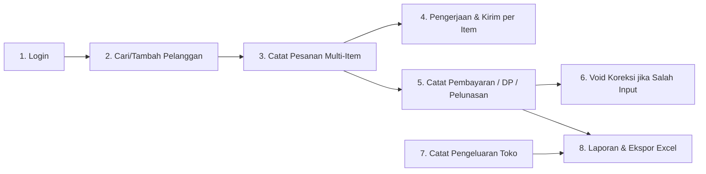

# Phase 7 — Operator User Flows & Simplification Analysis
**Mutiara Florist Management System (MFMS)**

Dokumen ini memetakan alur kerja aktual operator toko berdasarkan simulasi langsung pada antarmuka React/Inertia (baseline PR #5), menghitung jumlah klik (*click count*) dan beban kognitif per tugas harian, serta mengidentifikasi peluang penyederhanaan alur untuk Phase 8 **tanpa mengubah satu pun logika finansial atau aturan bisnis MVP**.

---

## 1. Peta Alur Utama Operator (End-to-End)

---

## 2. Pengukuran Alur & Jumlah Klik Aktual

Catatan: Penghitungan "klik" mencakup klik navigasi, fokus/buka dropdown, dan tombol submit (tidak menghitung ketikan huruf pada keyboard), dimulai dari kondisi sudah login di Dashboard (`/ui-dashboard`) kecuali alur Login.

### Flow A — Login Operator (`UC-01`)
- **Jalur Saat Ini:** Buka `/` → redirect `/login` → isi email → isi password → klik `Masuk` → redirect `/ui-dashboard`.
- **Jumlah Klik:** 3 klik (field email sudah `autoFocus`, klik password, klik `Masuk`).
- **Friksi Terukur:**
  1. Tidak ada tombol tampilkan password; karena aturan password minimal 12 karakter, operator rentan salah ketik berulang kali.
  2. Link `Tampilan Login Klasik (Blade Fallback) →` berada tepat di bawah tombol `Masuk` sehingga rawan terklik operator nonteknis.
- **Target Phase 8:** 2–3 klik, hapus link Blade fallback, tambah tombol *eye toggle* password.

### Flow B — Pelanggan Baru → Mulai Buat Pesanan (`UC-02` → `UC-03`)
- **Jalur Saat Ini:**
  1. Dari Dashboard: klik `Pelanggan` (sidebar) `[1]`.
  2. Klik `Tambah pelanggan` `[2]`.
  3. Isi nama, telepon, catatan → klik `Simpan pelanggan` `[3]` → redirect ke `/ui-customers/{id}` (Detail Pelanggan).
  4. **Jalan buntu di Detail Pelanggan:** tidak ada tombol `+ Buat pesanan`! Operator harus:
  5. Klik `Pesanan` (sidebar) `[4]`.
  6. Klik `+ + Buat pesanan` `[5]`.
  7. Buka dropdown `Pelanggan *` `[6]` lalu **scroll manual daftar alfabet** untuk mencari pelanggan yang baru dibuat `[7]` (karena default terisi `customers[0]`!).
- **Total Klik (Sebelum Mulai Isi Bunga):** **7 klik** + risiko salah pilih pelanggan default!
- **Skenario Gagal Saat Ini (Dari Form Pesanan):** Jika operator sudah terlanjur mengisi 2 item bunga di `/ui-orders/create` lalu sadar pemesannya belum terdaftar dan mengklik `+ Tambah pelanggan baru`, Inertia memindahkannya ke `/ui-customers/create` dan **seluruh isian item bunga hilang**.
- **Peluang Penyederhanaan (Tanpa Ubah Logika):**
  - Tambahkan tombol `+ Buat pesanan` di `/ui-customers/{id}` yang mengarah ke `/ui-orders/create?customer_id={id}` → memangkas langkah 4–7 (**hemat 4 klik**).
  - Tambahkan **Quick-Add Customer Modal** langsung di dalam `/ui-orders/create` sehingga form pesanan yang sudah diisi tidak hilang saat membuat pelanggan baru.
  - Ganti `<select>` polos dengan **searchable customer combobox** tanpa pre-select `customers[0]`.

### Flow C — Mencatat Pesanan 1 Item dengan Pembayaran Lunas di Awal (`UC-03` + `UC-05`)
Skenario tersering di toko bunga (pelanggan WA langsung transfer lunas saat pesan):
- **Jalur Saat Ini:**
  1. Klik `Pesanan` `[1]` → klik `+ + Buat pesanan` `[2]`.
  2. Pilih pelanggan `[3][4]`, isi tanggal & 9 kolom item (`Jenis bunga`, `Tanggal kirim`, `Untuk`, `Dari`, `Lokasi`, `Qty`, `Harga`, `Mode ongkir`, `Ongkir`).
  3. Scroll ke bawah → klik `Simpan pesanan` `[5]`.
  4. Redirect ke `/ui-orders/{id}` dengan pesan `"Pesanan berhasil dibuat. Pembayaran belum dicatat."`.
  5. Klik `+ Catat pembayaran` `[6]` → modal terbuka.
  6. Cek nominal default (sudah terisi penuh), pilih metode `[7][8]`, isi referensi, klik `Simpan Pembayaran` `[9]`.
- **Total Klik:** **9 klik** + 1 perpindahan halaman paksa + scroll panjang.
- **Friksi Terukur:**
  - Di `Orders/Create`, 10 label item tidak terikat `htmlFor` (klik label tidak memfokuskan input).
  - Default `unit_price = 0` memaksa operator menghapus nol sebelum mengetik harga.
  - Mode ongkir `INCLUDED` tetap menampilkan field `Ongkir tambahan (Rp)` dalam keadaan abu-abu/readonly, menambah kebisingan visual pada form yang sudah panjang.
  - Ketika total 0, tombol `Simpan pesanan` mati tanpa memberi tahu alasannya.
- **Peluang Penyederhanaan (Tanpa Ubah Logika Finansial):**
  - Sembunyikan field `Ongkir tambahan` saat mode `INCLUDED` (atau jadikan toggle ringkas `Ongkir: Termasuk | Tambah Ongkir`).
  - Beri opsi **"Duplikat item"** pada baris bunga (sangat sering terjadi untuk 2–3 papan bunga/buket ke tanggal atau tujuan berbeda dengan pengirim & harga sama → menghemat 60–70% pengetikan!).
  - Pada banner sukses / modal pasca-simpan order (atau opsi shortcut di `Orders/Create` yang mengeksekusi langkah bayar berurutan setelah order berhasil dibuat, atau langsung membuka drawer/aksi bayar di `Orders/Show`), kurangi gesekan transisi dari "Simpan order" ke "Catat bayar". *(Catatan: tetap menjaga aturan `BUSINESS_RULES.md` bahwa `orders` dan `payments` tercatat dengan idempotency key dan lock transaksi yang aman).*

### Flow D — Memajukan Status Pengerjaan Bunga di Workshop/Kurir (`UC-04`)
Skenario paling sering di smartphone (`390×844`):
- **Jalur Saat Ini (dari Dashboard):**
  1. Buka menu hamburger `[1]` → klik `Pesanan` `[2]`.
  2. Cari nomor/nama atau scroll tabel horizontal/vertikal → klik `Lihat` `[3]` (di mobile saat ini terpotong di luar layar!).
  3. Scroll melewati 4 kartu statistik dan kartu `Pengerjaan pesanan` (~700px di mobile) untuk mencapai kartu `Bunga 1` → klik tombol aksi status (`Rangkai / Proses Bunga →`) `[4]`.
  4. Di modal konfirmasi: klik `Ya, Majukan Status` `[5]`.
  5. Ulangi langkah 1–5 untuk setiap tahap (`Baru` → `Diproses` → `Siap kirim` → `Terkirim`).
- **Total Klik:** **5 klik per tahap** (15 klik untuk 1 item sampai terkirim!), ditambah scroll panjang di smartphone.
- **Friksi Terukur:**
  - Dashboard tidak menampilkan pesanan `Baru` / `Diproses` / jatuh tempo kirim hari ini.
  - Daftar `/ui-orders` tidak menampilkan `delivery_date` maupun `recipient`, padahal perangkai/kurir mencari bunga berdasarkan **tanggal kirim hari ini dan nama penerima**, bukan nomor ULID!
  - Di `/ui-orders/{id}`, teks bantuan pada status `Siap kirim` berbunyi `"Pesanan telah diterima oleh penerima di alamat tujuan."` sehingga membingungkan operator sebelum menekan tombol.
- **Peluang Penyederhanaan (Tanpa Ubah Logika Linier):**
  - Tampilkan **Antrean Hari Ini / Besok** di Dashboard dengan akses 1 klik ke pesanan terkait.
  - Tampilkan **tanggal kirim & penerima** di kartu daftar `/ui-orders` (dan filter cepat `Semua | Baru | Diproses | Siap Kirim | Selesai` berupa tab/chip, bukan `<select>` + tombol `Terapkan`).
  - Perbaiki copy deskripsi status agar membedakan status saat ini vs aksi tahap berikutnya.

### Flow E — Menagih & Mencatat Pelunasan Piutang (`UC-05`)
- **Jalur Saat Ini:**
  1. Klik `Pembayaran` (sidebar) `[1]`.
  2. Cari nama pelanggan (isi kotak cari + klik `Cari` `[2]`).
  3. Pada mobile/tablet, scroll tabel ke kanan untuk menemukan link `Lihat & Catat`, klik `[3]` → pindah ke `/ui-orders/{id}`.
  4. Klik `+ Catat pembayaran` `[4]`.
  5. Pilih metode `[5][6]`, klik `Simpan Pembayaran` `[7]`.
- **Total Klik:** **7 klik** + perpindahan ke halaman lain padahal hanya ingin melunasi piutang.
- **Peluang Penyederhanaan:**
  - Sediakan tombol **Catat Bayar** langsung di setiap baris/kartu pada halaman `/ui-payments` yang membuka Modal Pembayaran untuk order tersebut (tetap mengirim ke `POST /ui-orders/{order}/payments` dengan idempotency UUID dan lock saldo!). Memangkas 2 klik + 1 pindah halaman.

### Flow F — Koreksi Kesalahan Input Pembayaran / Pengeluaran (Void `UC-06` & `UC-07`)
- **Jalur Saat Ini (Pembayaran):**
  1. Buka Detail Pesanan → scroll ke bagian paling bawah `Riwayat pembayaran` → klik link kecil `Koreksi kesalahan pencatatan (Void) →` (tinggi hanya 16px) `[1]`.
  2. Baca peringatan merah/kuning, isi alasan minimal 10 karakter, klik `Void Pencatatan` `[2]`.
  3. Lalu jika ingin mencatat nominal yang benar: klik `+ Catat pembayaran` `[3]`, isi ulang semua field, klik `Simpan Pembayaran` `[4]`.
- **Jalur Saat Ini (Pengeluaran):**
  1. Klik `Pengeluaran` `[1]` → di mobile scroll horizontal jauh ke kanan untuk menemukan `Koreksi catatan` (16px) `[2]`.
  2. Isi alasan >= 10 karakter, klik `Void pencatatan` `[3]`.
- **Friksi Terukur:**
  - Tidak ada penghitung karakter (*character counter*) di textarea `Alasan koreksi (minimal 10 karakter)` sehingga operator menebak-nebak saat tombol Void masih disabled (`voidReason.trim().length < 10`).
  - Pada `Expenses/Index`, tanggal tampil `2026-11-16T17:00:00.000000Z` sehingga operator kesulitan memverifikasi baris pengeluaran mana yang salah input!
- **Peluang Penyederhanaan:**
  - Tampilkan indikator progres karakter (`6/10 karakter minimum`), perbesar target klik tombol Void, dan perbaiki format tanggal WIB + prefix `Rp` pada `Expenses/Index`.

### Flow G — Mencatat Pengeluaran & Mengelola Kategori (`UC-07`)
- **Jalur Saat Ini:**
  1. Klik `Pengeluaran` `[1]` → klik `Catat pengeluaran` `[2]`.
  2. Pilih kategori `[3][4]`, tanggal, nominal (tanpa pemisah ribuan), keterangan → klik `Simpan pengeluaran` `[5]`.
  3. Jika kategori belum ada: klik `Kelola kategori` `[3]` (menavigasi keluar dari form create, menghapus nominal/keterangan yang sudah diketik!), tambah kategori, lalu klik `Kembali ke pengeluaran` → klik `Catat pengeluaran` lagi.
- **Peluang Penyederhanaan:**
  - Sediakan tombol `+ Catat pengeluaran` atau quick-action dari Dashboard, dan tombol `+ Kategori baru` inline/modal di form `Catat pengeluaran` agar input tidak hilang.
  - Ganti `window.confirm()` di `ExpenseCategories/Index` dengan modal aplikasi yang konsisten.

### Flow H — Melihat Laporan & Ekspor Excel (`UC-08`, `UC-09`)
- **Jalur Saat Ini:**
  1. Klik `Laporan` `[1]`.
  2. Pilih preset (`Hari Ini`, `7 Hari`, `30 Hari`, `Bulan Ini`, `Bulan Lalu`, `Kustom`) `[2]`.
  3. Jika `Kustom`: klik `Kustom` `[2]`, pilih `Dari Tanggal` `[3]`, pilih `Sampai Tanggal` `[4]`, klik `Terapkan Rentang` `[5]`.
  4. Klik `Ekspor Excel (.xlsx)` `[6]`.
- **Friksi Terukur:**
  - Saat periode `30 Hari`, 14–20 baris kosong (`-`) muncul di atas baris bertransaksi sehingga operator harus scroll panjang.
  - Istilah teknis (`kolom order_date`, `(NEW)`, `(PROCESSING)`, `(UNPAID)`) membingungkan pemilik/operator.

---

## 3. Ringkasan Peluang Penghematan Klik & Friksi (Phase 8)

| Alur Tugas Harian | Klik Saat Ini | Target Phase 8 | Pengurangan Friksi Utama (Tanpa Ubah Logika Finansial) |
| --- | --- | --- | --- |
| Pelanggan baru → Form Pesanan | 7 klik | **3 klik** | Tombol `+ Buat pesanan` di Detail Pelanggan + modal tambah pelanggan cepat di form order |
| Catat Pesanan 2 item sejenis | ~18 aksi input | **~10 aksi** | Tombol `Duplikat item`, sembunyikan ongkir saat `INCLUDED`, `<CurrencyInput>` tanpa default `0` |
| Majukan status 1 item dari Dashboard | 5 klik + scroll | **2–3 klik** | Antrean pengiriman hari ini di Dashboard + filter chip 1-klik di Pesanan |
| Catat pelunasan dari Piutang | 7 klik (2 halaman) | **4 klik (1 halaman)** | Aksi cepat `Catat Bayar` langsung membuka modal dari daftar `/ui-payments` |
| Void salah input (Bayar/Biaya) | 2–3 klik (rawan salah baris) | **2–3 klik jelas** | Tanggal WIB `dd/mm/yyyy` akurat + `Rp` prefix + counter `min 10 karakter` |
| Logout dari Smartphone | Terpotong / tidak terlihat | **1–2 klik** | Fix scroll & sticky footer di mobile drawer + `Escape` untuk tutup |

---

## 4. Batas Ketat yang Dipertahankan (Non-Negotiable Invariants)

Seluruh penyederhanaan alur di atas **wajib mempertahankan 100%** aturan bisnis MFMS:
1. Perhitungan total tagihan tetap `Σ (quantity × unit_price + shipping_fee_if_separate)` di server (`OrderService`).
2. Tidak ada diskon, pajak, pembatalan order (`CANCELLED`), atau refund otomatis.
3. Pembayaran tetap menggunakan event `POSTED` / `VOIDED` dengan `idempotency_key` UUID unik, `lockForUpdate()`, dan anti-overpayment guard.
4. Perubahan status item tetap berjalan bertahap linier (`NEW → PROCESSING → READY → DELIVERED`); order `COMPLETED` hanya jika seluruh item `DELIVERED`.
5. Status bayar (`UNPAID` / `PARTIAL` / `PAID`) dan status pengerjaan tetap independen.
6. Pengeluaran tidak mengurangi nilai penjualan; void transaksi wajib alasan minimal 10 karakter dan tercatat di `audit_logs`.
