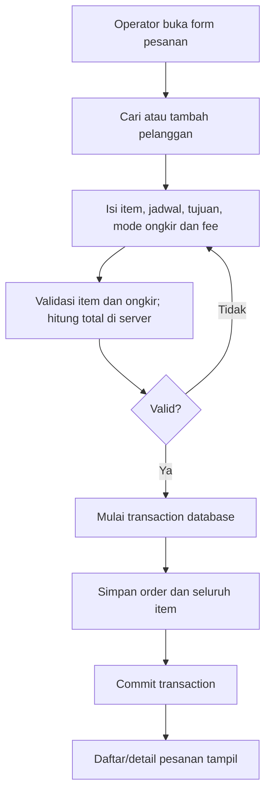
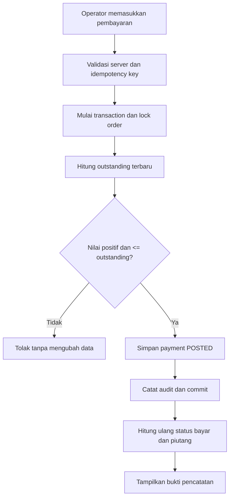

# Workflow & Use Cases — MFMS
**Versi:** v0.4 · **Status:** pembayaran opsional, pelunasan awal/akhir; pembatalan bukan fitur MVP, implementasi belum diuji.

## Aktor
**Operator/admin tunggal** menggunakan laptop lokal. Tidak ada akun pelanggan, supplier, atau pemilik terpisah pada MVP.

## Use cases

| ID | Use case | Pra-kondisi | Keluaran |
| --- | --- | --- | --- |
| UC-01 | Login | Akun operator ada | Sesi terautentikasi |
| UC-02 | Tambah/cari pelanggan | Operator login | Data customer tersedia |
| UC-03 | Catat pesanan multi-item, jadwal/tujuan, mode ongkir dan fee per item | Pelanggan dipilih | Order + jadwal/tujuan/harga/ongkir masing-masing item + total tersimpan atomik |
| UC-04 | Ubah status pengerjaan per item | Order aktif | Status item diperbarui, ringkasan order dihitung ulang |
| UC-05 | Catat pembayaran opsional (lunas awal, lunas belakangan atau DP jika ada) | Saldo terutang > 0 | Payment POSTED, status bayar & sisa tagihan terkini |
| UC-06 | Koreksi input pembayaran | Payment salah | Payment VOIDED dengan alasan/audit |
| UC-07 | Catat/koreksi pengeluaran | Kategori tersedia | Expense POSTED/VOIDED |
| UC-08 | Lihat dashboard & laporan | Data tersedia | Agregat penjualan, kas, piutang |
| UC-09 | Ekspor laporan | Filter tanggal dipilih | File Excel |
| UC-10 | Backup dan uji restore | Operator/login & media cadangan tersedia | Backup terverifikasi, log hasil |

## Alur pesanan (target)



**Saat membuat pesanan:** pembayaran boleh dilewati tanpa membuat baris `payments`; status otomatis UNPAID. Jika pelanggan sudah membayar penuh di awal, buat satu pembayaran POSTED senilai total tagihan. Jika pembayaran diberikan di akhir, order tetap dapat berjalan hingga COMPLETED sementara status bayar UNPAID.

## Alur pembayaran (target)



**Perhitungan harga:** subtotal per item = qty × unit_price + shipping_fee jika mode SEPARATE. Jika INCLUDED, shipping_fee wajib 0; mode campuran antar-item diperbolehkan. Perubahan harga/ongkir setelah DP harus divalidasi secara atomik terhadap paid_amount. Lihat [PRICING_AND_SHIPPING](PRICING_AND_SHIPPING.md).

Koreksi input payment: tindakan void terpisah, memerlukan alasan, mencatat siapa dan kapan; **refund dana nyata belum diimplementasikan**.

## Aturan status dan pengiriman per item

```text
Item A: tanggal 10, lokasi A: NEW -> PROCESSING -> READY -> DELIVERED
Item B: tanggal 13, lokasi B: NEW -> PROCESSING -> READY -> DELIVERED
Order: COMPLETED hanya setelah SEMUA item DELIVERED
```

Jika sebagian item sudah terkirim, ringkasan order tetap **PROCESSING** sampai seluruh item memenuhi kondisi penyelesaian. **Order berstatus COMPLETED bisa masih UNPAID/PARTIAL**; keduanya independen. **Tidak tersedia pembatalan order/item atau refund pada MVP**, karena tidak ada kebutuhan yang dilaporkan. Koreksi status manual perlu audit.

## Alur laporan

1. Operator memilih periode.
2. Penjualan: agregasi seluruh order pada MVP menurut tanggal order; tidak ada status CANCELLED di MVP.
3. Uang masuk: pembayaran POSTED menurut tanggal pembayaran.
4. Uang keluar: pengeluaran POSTED menurut tanggal pengeluaran. Jika florist membayar kurir, biaya pengiriman nyata masuk expenses dan tidak otomatis sama dengan ongkir yang ditagih.
5. Piutang: **saldo saat ini** seluruh order yang belum lunas (termasuk item yang sudah dikirim), diberi label sesuai.
6. Tampilkan dashboard atau ekspor data berdasarkan definisi yang sama.

**Larangan perhitungan ganda:** pembayaran tidak juga dibuat sebagai row pemasukan yang dijumlahkan ulang. Ongkir SEPARATE hanya menjadi bagian tagihan, **bukan** pembayaran tunai tambahan di luar payments. Total pesanan bukan penerimaan kas.

## Alur keamanan dan backup

- Akses aplikasi dilindungi sesi/login dan server-side validation.
- Database dump dibuat konsisten; lampiran disertakan jika fitur aktif.
- Backup dienkripsi sebelum disalin keluar laptop; hasilnya dicatat dan diuji restore ke database uji.
- Operasional MySQL/Laravel lokal bergantung pada laptop menyala. Google Drive memerlukan internet saat unggah.

Lihat [PRD](PRD.md), [DATABASE](DATABASE.md), dan [BUSINESS_RULES](BUSINESS_RULES.md).
