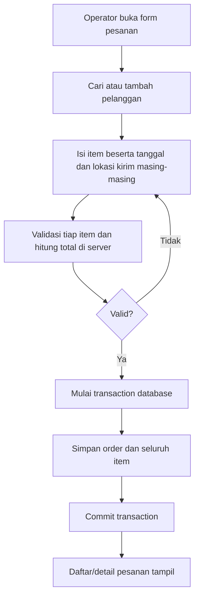
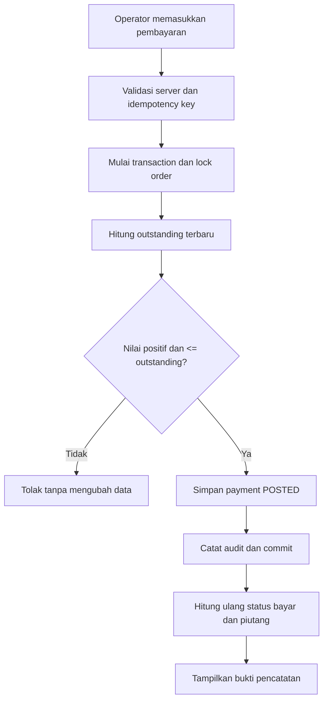

# Workflow & Use Cases — MFMS
**Versi:** v0.2 · **Status:** pengiriman per item disepakati, implementasi belum diuji.

## Aktor
**Operator/admin tunggal** menggunakan laptop lokal. Tidak ada akun pelanggan, supplier, atau pemilik terpisah pada MVP.

## Use cases

| ID | Use case | Pra-kondisi | Keluaran |
| --- | --- | --- | --- |
| UC-01 | Login | Akun operator ada | Sesi terautentikasi |
| UC-02 | Tambah/cari pelanggan | Operator login | Data customer tersedia |
| UC-03 | Catat pesanan multi-item dengan tanggal dan tujuan kirim berbeda per item | Pelanggan dipilih | Order + jadwal/tujuan setiap item + total tersimpan atomik |
| UC-04 | Ubah status pengerjaan per item | Order aktif | Status item diperbarui, ringkasan order dihitung ulang |
| UC-05 | Terima DP/pelunasan | Saldo terutang > 0 | Payment POSTED dan sisa tagihan baru |
| UC-06 | Koreksi input pembayaran | Payment salah | Payment VOIDED dengan alasan/audit |
| UC-07 | Catat/koreksi pengeluaran | Kategori tersedia | Expense POSTED/VOIDED |
| UC-08 | Lihat dashboard & laporan | Data tersedia | Agregat penjualan, kas, piutang |
| UC-09 | Ekspor laporan | Filter tanggal dipilih | File Excel |
| UC-10 | Backup dan uji restore | Operator/login & media cadangan tersedia | Backup terverifikasi, log hasil |

## Alur pesanan (target)



## Alur pembayaran (target)



Koreksi input payment: tindakan void terpisah, memerlukan alasan, mencatat siapa dan kapan; **refund dana nyata belum diimplementasikan**.

## Aturan status dan pengiriman per item

```text
Item A: tanggal 10, lokasi A: NEW -> PROCESSING -> READY -> DELIVERED
Item B: tanggal 13, lokasi B: NEW -> PROCESSING -> READY -> DELIVERED
Order: COMPLETED hanya setelah SEMUA item DELIVERED
```

Jika sebagian item sudah terkirim, ringkasan order tetap **PROCESSING** sampai seluruh item memenuhi kondisi penyelesaian. Pembatalan order hanya untuk order tanpa pembayaran pada MVP; pembatalan per item dan refund belum tersedia. Koreksi status manual perlu audit.

## Alur laporan

1. Operator memilih periode.
2. Penjualan: agregasi order non-cancel menurut tanggal order.
3. Uang masuk: pembayaran POSTED menurut tanggal pembayaran.
4. Uang keluar: pengeluaran POSTED menurut tanggal pengeluaran.
5. Piutang: **saldo saat ini** untuk order aktif, diberi label sesuai.
6. Tampilkan dashboard atau ekspor data berdasarkan definisi yang sama.

**Larangan perhitungan ganda:** pembayaran tidak juga dibuat sebagai row pemasukan yang dijumlahkan ulang. Total pesanan bukan penerimaan kas.

## Alur keamanan dan backup

- Akses aplikasi dilindungi sesi/login dan server-side validation.
- Database dump dibuat konsisten; lampiran disertakan jika fitur aktif.
- Backup dienkripsi sebelum disalin keluar laptop; hasilnya dicatat dan diuji restore ke database uji.
- Operasional MySQL/Laravel lokal bergantung pada laptop menyala. Google Drive memerlukan internet saat unggah.

Lihat [PRD](PRD.md), [DATABASE](DATABASE.md), dan [BUSINESS_RULES](BUSINESS_RULES.md).
