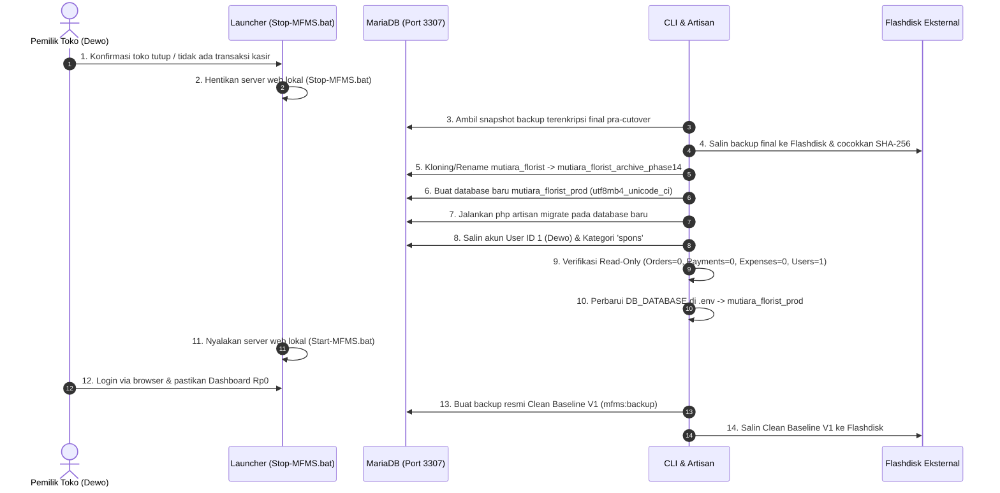

# MFMS — Rencana Pengarsipan Data Pengujian & Baseline Operasional Bersih (Fase 14A)

**Dokumen Kontrol:** `docs/phase14/PHASE14A_CLEAN_BASELINE_PLAN.md`  
**Tanggal Penyusunan:** 20 November 2026  
**Status Fase:** **PLANNING ONLY (Belum Ada Izin Eksekusi / Cutover)**  
**Git Baseline Main:** `45d3b7e411e16ba2f45ca3b367a9addadbb722c2`  
**Database Operasional Saat Ini:** `mutiara_florist` (MariaDB Port 3307)  
**Status Mutasi Database:** **0 Mutasi (Audit READ-ONLY 100% Non-Destruktif)**  

---

## 1. Executive Summary

Berdasarkan keputusan resmi Pemilik Toko (*Owner Decision*), seluruh transaksi historis yang tercatat pada database operasional `mutiara_florist` dikonfirmasi sebagai **data pengujian perangkat lunak (*software test data*)**, bukan transaksi riil toko Mutiara Florist. Data tersebut meliputi:
- **2 Pesanan Historis** bernilai total Rp1.600.000.
- **4 Item Bunga** (papan ucapan, buket, bunga 1, bunga 2).
- **2 Pembayaran Masuk** bernilai total Rp1.300.000.
- **1 Pengeluaran Operasional** bernilai Rp100.000.
- **Piutang Terbuka** senilai Rp300.000.

Tujuan dari Fase 14A adalah menyusun perencanaan komprehensif untuk memulai pembukuan operasional dari **baseline bersih (*clean baseline*)** bernilai Rp0, dengan tetap **mengarsipkan dan mempertahankan seluruh bukti riwayat pengujian dan log audit tanpa ada data yang hilang atau dimusnahkan**.

> [!IMPORTANT]
> **STATUS FASE 14A: PERENCANAAN MURNI (PLANNING ONLY)**  
> Sesuai aturan keselamatan ketat (*Hard Safety Rules*), pada fase ini:
> - Database operasional `mutiara_florist` diperlakukan secara **READ-ONLY**.
> - **TIDAK ADA** database baru yang dibuat atau dihapus.
> - **TIDAK ADA** migrasi (`migrate`), pemotongan (`TRUNCATE`), atau penghapusan data (`DELETE`) yang dijalankan.
> - **TIDAK ADA** perubahan konfigurasi `.env`, `APP_KEY`, atau koneksi database.
> - Seluruh prosedur eksekusi dipetakan dalam bentuk *Runbook* yang membutuhkan persetujuan tertulis (*Explicit Owner Approval Gate*) sebelum dieksekusi pada fase berikutnya.

---

## 2. Inventory Database Historis (Read-Only Source Inventory)

Audit teknis secara *read-only* terhadap basis data `mutiara_florist` (MariaDB port 3307) menghasilkan inventaris lengkap sebagai berikut:

### 2.1. Daftar Tabel & Jumlah Baris

```
+--------------------------+------------+-----------------------------------------------------------+
| Nama Tabel               | Jml Baris  | Kategori & Deskripsi Fungsi                               |
+--------------------------+------------+-----------------------------------------------------------+
| users                    | 2 rows     | Autentikasi Pengguna (1 Operator Resmi, 1 Akun Terkunci)  |
| customers                | 2 rows     | Master Pelanggan (Data pengujian "test 2" dan "coba1")    |
| expense_categories       | 1 row      | Master Kategori Pengeluaran ("spons", Aktif)              |
| orders                   | 2 rows     | Transaksi Pesanan Historis                                |
| order_items              | 4 rows     | Rincian Item Bunga Pesanan                                |
| payments                 | 2 rows     | Transaksi Pembayaran Masuk (Lunas untuk Pesanan #1)       |
| expenses                 | 1 row      | Transaksi Pengeluaran Operasional                         |
| audit_logs               | 17 rows    | Catatan Jejak Audit Akuntansi & Perubahan Data            |
| migrations               | 6 rows     | Riwayat Migrasi Skema Basis Data Laravel                  |
| sessions                 | 23 rows    | Penyimpanan Sesi Web Browser Operator/Testing             |
| cache                    | 2 rows     | Cache Aplikasi Laravel                                    |
| cache_locks              | 0 rows     | Lock Cache Transaksional                                  |
| jobs                     | 0 rows     | Antrean Pekerjaan (Queue)                                 |
| job_batches              | 0 rows     | Batch Pekerjaan Antrean                                   |
| failed_jobs              | 0 rows     | Antrean Pekerjaan Gagal                                   |
| password_reset_tokens    | 0 rows     | Token Reset Kata Sandi                                    |
+--------------------------+------------+-----------------------------------------------------------+
```

### 2.2. Relasi Foreign Key & Batasan Integritas Referensial
Semua relasi tabel transaksional dilindungi oleh *Foreign Key Constraints* dengan mode `RESTRICT ON DELETE`:

```
orders.customer_id          ──> customers.id           [RESTRICT] (Mencegah hapus pelanggan yang punya pesanan)
orders.created_by           ──> users.id               [RESTRICT] (Mencegah hapus user pembuat pesanan)
order_items.order_id        ──> orders.id              [RESTRICT] (Mencegah hapus pesanan yang punya item bunga)
payments.order_id           ──> orders.id              [RESTRICT] (Mencegah hapus pesanan yang punya pembayaran)
payments.recorded_by        ──> users.id               [RESTRICT] (Mencegah hapus kasir pencatat pembayaran)
expenses.expense_category_id──> expense_categories.id  [RESTRICT] (Mencegah hapus kategori yang memiliki beban)
expenses.recorded_by        ──> users.id               [RESTRICT] (Mencegah hapus user pencatat beban)
audit_logs.actor_user_id    ──> users.id               [SET NULL] (Mempertahankan audit log jika user dihapus)
```

> [!CAUTION]
> Batasan `RESTRICT ON DELETE` di atas membuktikan bahwa upaya penghapusan data secara parsial menggunakan perintah SQL biasa (`DELETE FROM customers` atau `DELETE FROM orders`) pada database operasional aktif **akan gagal akibat pelanggaran Foreign Key** dan berisiko merusak integritas referensial.

### 2.3. Rincian Akun Pengguna (`users`)
1. **User ID 1 (`Dewo` / `[REDACTED_OWNER_EMAIL]`):**
   - Peran: Operator Resmi / Pemilik Toko.
   - Status: **AKTIF & AMAN** (Hash SHA-256 fingerprint: `305b24a2c345f72b`).
   - Aktivitas Historis: Membuat Customer #1, Order #1, dan memiliki 3 entri dalam audit logs.
2. **User ID 2 (`Nonaktif - Eks Akun Pengujian` / `disabled-qa-2@disabled.invalid`):**
   - Peran: Akun demo/pengujian pra-go-live.
   - Status: **TERKUNCI PERMANEN** (Hash SHA-256 fingerprint: `5bb54992d38bf5a9`, `remember_token: NULL`, total sesi aktif: 0).
   - Aktivitas Historis: Membuat Customer #2, Order #2, 2 Pembayaran, 1 Beban, 1 Kategori Beban, dan memiliki 14 entri dalam audit logs.

### 2.4. Rincian Jejak Audit (`audit_logs`)
17 baris catatan jejak audit tersimpan kronologis sejak 02 November 2026 hingga 17 November 2026:
- 2 log pembuatan & pembaruan pelanggan.
- 2 log pembuatan & pembaruan pesanan.
- 2 log penerimaan pembayaran (*payment posted*).
- 2 log pembuatan kategori & pencatatan biaya operasional.
- 9 log pembaruan progres linear status pemenuhan bunga (*item fulfillment*).

---

## 3. Matriks Klasifikasi Data (Data Classification Matrix)

Berdasarkan keputusan pemilik bahwa seluruh transaksi di atas adalah data pengujian, berikut klasifikasi setiap entitas:

```
+--------------------+------------+--------------------------+-----------------------------------------------------------+
| Entitas / Record   | Jumlah     | Klasifikasi              | Rasional & Tindakan Rekomendasi                           |
+--------------------+------------+--------------------------+-----------------------------------------------------------+
| orders             | 2 records  | ARCHIVE ONLY             | Data uji coba; diarsipkan 100%, tidak disalin ke baseline.|
| order_items        | 4 records  | ARCHIVE ONLY             | Rincian uji coba; diarsipkan 100% bersama orders.         |
| payments           | 2 records  | ARCHIVE ONLY             | Bukti uji transfer Rp1.3jt; diarsipkan, kas baseline Rp0. |
| expenses           | 1 record   | ARCHIVE ONLY             | Bukti uji biaya Rp100rb; diarsipkan, kas keluar Rp0.      |
| audit_logs         | 17 records | ARCHIVE ONLY             | Jejak audit historis pengujian; tetap utuh di arsip.     |
| User ID 2          | 1 record   | ARCHIVE ONLY             | Akun testing terkunci; diarsipkan, tidak aktif di prod.   |
| sessions           | 23 records | ARCHIVE ONLY             | Sesi browser masa pengujian; tidak disalin ke baseline.   |
+--------------------+------------+--------------------------+-----------------------------------------------------------+
| User ID 1 (Dewo)   | 1 record   | PRESERVE IN BASELINE     | Operator resmi & terverifikasi; disalin ke database baru. |
| Skema & Migrasi    | 6 migrasi  | PRESERVE IN BASELINE     | Struktur tabel resmi dieksekusi bersih via migrasi baru.  |
| Tabel Sistem Cache | -          | PRESERVE IN BASELINE     | Struktur cache, jobs, failed_jobs disiapkan bersih.       |
+--------------------+------------+--------------------------+-----------------------------------------------------------+
| Customer ID 1 & 2  | 2 records  | REQUIRES OWNER REVIEW    | "test 2" & "coba1" terbukti nama dummy.                   |
|                    |            | (Rekomendasi: ARCHIVE)   | Opsi Rekomendasi: Disimpan di arsip, daftar pelanggan = 0|
| Kategori "spons"   | 1 record   | REQUIRES OWNER REVIEW    | Spons adalah bahan florist nyata, dibuat saat testing.    |
|                    |            | (Rekomendasi: PRESERVE)  | Opsi Rekomendasi: Dipertahankan di baseline baru.         |
+--------------------+------------+--------------------------+-----------------------------------------------------------+
```

---

## 4. Perbandingan Arsitektur: Opsi A vs Opsi B

Untuk mencapai baseline operasional bersih, dilakukan evaluasi mendalam antara dua pendekatan teknis:

* **Opsi A (Rekomendasi Utama):** Mengarsipkan seluruh database historis `mutiara_florist` menjadi database arsip terpisah (`mutiara_florist_archive_phase14`), kemudian menyiapkan database operasional baru yang benar-benar bersih melalui eksekusi migrasi skema resmi Laravel.
* **Opsi B:** Mempertahankan database yang sama dan melakukan pembatalan (*administrative VOID*) pada seluruh transaksi historis melalui antarmuka kasir.

### Tabel Matriks Evaluasi:

```
+--------------------------------------+------------------------------------+------------------------------------+
| Parameter Evaluasi                   | Opsi A: Database Bersih + Arsip    | Opsi B: Koreksi VOID pada DB Lama  |
+--------------------------------------+------------------------------------+------------------------------------+
| 1. Kepastian Saldo Nol (Pristine Rp0)| SANGAT SEMPURNA                    | TIDAK SEMPURNA                     |
|                                      | Kas Masuk: Rp0, Keluar: Rp0,       | Laporan menunjukkan Kas Rp1.3jt    |
|                                      | Piutang: Rp0, Pesanan: 0.          | dibatalkan oleh Void Rp1.3jt.      |
+--------------------------------------+------------------------------------+------------------------------------+
| 2. Kebersihan Penomoran & Auto-Inc   | BERSIH TOTAL                       | TERCEMAR                           |
|                                      | ID pesanan dan invoice kasir mulai | Nomor ID pesanan kasir dimulai dari|
|                                      | kembali dari urutan #1.            | ID #3 (membingungkan pembukuan).   |
+--------------------------------------+------------------------------------+------------------------------------+
| 3. Preservasi Jejak Audit Historis   | 100% UTUH TERLINDUNGI              | TERCAMPUR ADUK                     |
|                                      | 17 audit logs lama tersimpan abadi | Log audit pengujian bercampur      |
|                                      | di DB arsip tanpa modifikasi.      | dengan log audit transaksi nyata.  |
+--------------------------------------+------------------------------------+------------------------------------+
| 4. Keamanan Foreign Key              | AMAN 100%                          | BERISIKO                           |
|                                      | Tidak memanipulasi baris database. | Customer "test 2" terkunci FK      |
|                                      | Skema baru dibuat murni.           | dan tidak bisa dibersihkan.        |
+--------------------------------------+------------------------------------+------------------------------------+
| 5. Keberlanjutan Akun Operator       | TERJAMIN                           | TERJAMIN                           |
|                                      | User ID 1 disalin persis           | User ID 1 tetap di tempat.         |
|                                      | (kredensial & password hash sama). |                                    |
+--------------------------------------+------------------------------------+------------------------------------+
| 6. Isolasi Akun Testing (User ID 2)  | ISOLASI TOTAL                      | MASIH MENEMPEL                     |
|                                      | User ID 2 tidak pernah ada pada    | User ID 2 masih berada di baris    |
|                                      | database operasional baru.         | tabel database produksi.           |
+--------------------------------------+------------------------------------+------------------------------------+
| 7. Kecepatan & Keamanan Rollback     | INSTAN & TANPA RISIKO              | SULIT                              |
|                                      | Cukup kembalikan DB_DATABASE di    | Membatalkan pembatalan transaksi   |
|                                      | .env ke database arsip.            | akan merusak integritas buku.      |
+--------------------------------------+------------------------------------+------------------------------------+
| 8. Risiko Kehilangan Data Riil       | NOL (Jika cutover sebelum transaksi| NOL                                |
|                                      | nyata pertama masuk toko).         |                                    |
+--------------------------------------+------------------------------------+------------------------------------+
```

### Kesimpulan Arsitektur:
**Opsi A adalah solusi standar industri yang paling aman, elegan, dan profesional.** Pendekatan ini memberikan jaminan 100% bahwa pembukuan toko Mutiara Florist dimulai tanpa noda data uji coba, tanpa mengorbankan kepatuhan audit.

---

## 5. Rancang Bangun Baseline Bersih (Clean Baseline Design)

Target keadaan (*target state*) database operasional baru:

### 5.1. Metrik Finansial & Operasional Awal
- `orders` = **0 record** (Total Nilai Penjualan: **Rp0**)
- `order_items` = **0 record**
- `payments` = **0 record** (Total Kas Masuk: **Rp0**)
- `expenses` = **0 record** (Total Kas Keluar: **Rp0**)
- `outstanding receivables` = **Rp0** (Piutang Terbuka: **Rp0**)
- `audit_logs` = **0 record baru** (17 record historis aman di database arsip)

### 5.2. Akun Pengguna Terpilih
- `users` = **Tepat 1 record**:
  - `id`: 1
  - `name`: `Dewo`
  - `email`: `[REDACTED_OWNER_EMAIL]`
  - `password`: *Hash resmi yang sama persis (fingerprint `305b24a2c345f72b`)*
  - `created_at`: 2026-11-02 12:44:48
- **User ID 2 TIDAK DIMASUKKAN** ke database operasional baru.

### 5.3. Data Master Sesuai Review Pemilik
- **Tabel `customers`:** 0 record (Daftar pelanggan bersih, siap diinput data pelanggan riil).
- **Tabel `expense_categories`:** 1 record (`spons`, status: `is_active = true`), disiapkan agar kasir langsung dapat mencatat pembelian bahan baku umum tanpa setup ulang.

### 5.4. Struktur Skema & Tabel Sistem
- Seluruh 6 file migrasi Laravel dieksekusi secara lengkap:
  1. `0001_01_01_000000_create_users_table`
  2. `0001_01_01_000001_create_cache_table`
  3. `0001_01_01_000002_create_jobs_table`
  4. `2026_11_02_000001_create_mfms_core_tables`
  5. `2026_11_02_000002_add_deleted_at_to_customers_table`
  6. `2026_11_02_000003_add_idempotency_key_to_expenses`
- Tabel sistem `sessions`, `cache`, `cache_locks`, `jobs`, `failed_jobs`, dan `password_reset_tokens` tersedia dalam keadaan kosong dan siap pakai.

---

## 6. Rencana Keselamatan Backup & Pengarsipan (Backup & Archive Safety Plan)

Untuk menjamin pemisahan yang mutlak antara data arsip pengujian dan data operasional baru:

### 6.1. Inventarisasi Backup Historis (Label: CONTAINS_TEST_DATA)
Seluruh backup terenkripsi yang telah dibuat hingga Fase 14 diklasifikasikan sebagai **Arsip Pengujian**:

```
+-------------------------------------------------------------+--------------+-----------------------+
| Nama File Backup (.enc & .meta.json)                        | Tanggal      | Klasifikasi Status    |
+-------------------------------------------------------------+--------------+-----------------------+
| mfms_backup_2026-11-17_112231_775931_59e15b7b               | 17 Nov 2026  | CONTAINS_TEST_DATA    |
| mfms_backup_2026-11-18_012445_708271_520924f5               | 18 Nov 2026  | CONTAINS_TEST_DATA    |
| mfms_backup_2026-11-18_101440_275008_39998ef3               | 18 Nov 2026  | CONTAINS_TEST_DATA    |
| mfms_backup_2026-11-18_102535_385272_1e166f4e               | 18 Nov 2026  | CONTAINS_TEST_DATA    |
| mfms_backup_2026-11-18_132339_819052_efcfd405               | 18 Nov 2026  | CONTAINS_TEST_DATA    |
| mfms_backup_2026-11-19_214215_719880_a13fb449 (Flashdisk)   | 19 Nov 2026  | CONTAINS_TEST_DATA    |
| mfms_backup_2026-11-19_222933_701075_b641435d (Flashdisk)   | 19 Nov 2026  | CONTAINS_TEST_DATA    |
+-------------------------------------------------------------+--------------+-----------------------+
```

### 6.2. Snapshot Final Pra-Cutover
Sesaat sebelum proses cutover dieksekusi di fase mendatang, perintah resmi:
```bash
php artisan mfms:backup
```
akan dijalankan untuk mengunci keadaan akhir database `mutiara_florist` ke dalam snapshot terenkripsi AES-256-GCM. Pasangan file `.enc` dan `.meta.json` ini akan disalin ke flashdisk eksternal sebagai salinan *off-site* terakhir era pengujian.

### 6.3. Pencegahan Restorasi Arsip Testing ke Database Operasional Baru
Sistem keamanan pada `BackupService::restoreTest` ([BackupService.php#L250-L304](../../../app/Services/BackupService.php#L250-L304)) secara inheren telah memproteksi risiko ini:
1. Perintah restore **dilarang keras berjalan di lingkungan `production`**.
2. Perintah restore **menolak target database bernama operasional** (`mutiara_florist`, `mfms`, `laravel`).
3. Target restorasi diwajibkan memiliki izin eksplisit `is_testing => true` dan berakhiran `_test` atau `_testing`.
4. File backup arsip lama ditandai secara metadata sehingga tidak akan pernah digunakan oleh skrip pemulihan darurat operasional.

---

## 7. Runbook Eksekusi Cutover (Future Cutover Runbook — NOT EXECUTED)

> [!WARNING]
> **PROSEDUR DI BAWAH INI TIDAK DIJALANKAN PADA FASE INI.**  
> Prosedur ini disiapkan secara rinci sebagai instruksi teknis langkah-demi-langkah yang hanya akan dieksekusi setelah persetujuan tertulis Pemilik Toko diberikan.



### Rincian Langkah Operasional Runbook:
1. **Langkah 1 (Jeda Penulisan):** Pastikan tidak ada aktivitas kasir. Jalankan `scripts\Stop-MFMS.bat` untuk mematikan listener HTTP di port 8000.
2. **Langkah 2 (Final Backup Pra-Cutover):** Eksekusi pencadangan terakhir database lama dan salin ke flashdisk USB.
3. **Langkah 3 (Pengarsipan MariaDB):**
   - Buat database arsip: `CREATE DATABASE mutiara_florist_archive_phase14 CHARACTER SET utf8mb4 COLLATE utf8mb4_unicode_ci;`
   - Salin seluruh isi `mutiara_florist` ke dalam `mutiara_florist_archive_phase14`.
4. **Langkah 4 (Penyediaan Database Bersih):**
   - Buat database operasional baru: `CREATE DATABASE mutiara_florist_prod CHARACTER SET utf8mb4 COLLATE utf8mb4_unicode_ci;`
5. **Langkah 5 (Migrasi Bersih Skema):**
   - Eksekusi migrasi skema lengkap ke database baru menggunakan koneksi aman.
6. **Langkah 6 (Migrasi Entitas Terpilih):**
   - Salin tepat 1 baris akun User ID 1 (`Dewo`) dari arsip ke database baru.
   - Salin tepat 1 baris kategori `spons` ke database baru.
7. **Langkah 7 (Verifikasi Integritas Nol):**
   - Eksekusi skrip verifikasi otomatis untuk memastikan:
     `orders = 0`, `order_items = 0`, `payments = 0`, `expenses = 0`, `audit_logs = 0`, `users = 1`, `customers = 0`.
8. **Langkah 8 (Peralihan Konfigurasi .env):**
   - Perbarui baris konfigurasi `.env`:
     `DB_DATABASE=mutiara_florist_prod`
9. **Langkah 9 (Pengaktifan Sistem):**
   - Jalankan `scripts\Start-MFMS.bat`.
   - Buka `http://127.0.0.1:8000`, login sebagai Dewo, dan konfirmasi Dashboard menyajikan angka Rp0.
10. **Langkah 10 (Pencadangan Baseline Bersih V1):**
    - Buat backup perdana era operasional bersih (`php artisan mfms:backup`) dan salin ke flashdisk eksternal.

---

## 8. Strategi Rollback & Pemulihan (Rollback & Recovery Strategy)

Terdapat perbedaan mendasar antara prosedur *rollback* sebelum transaksi nyata pertama masuk dan prosedur *recovery* setelah transaksi riil pelanggan mulai dicatat:

### 8.1. Skenario A: Rollback SEBELUM Transaksi Riil Pertama Dimulai
* **Kondisi:** Cutover baru saja selesai, namun operator mendeteksi adanya kejanggalan sistem (misal: gagal login atau error rendering UI) sebelum ada pesanan pembeli fisik yang diinput.
* **Prosedur:**
  1. Hentikan server: `scripts\Stop-MFMS.bat`.
  2. Kembalikan file `.env`: ubah `DB_DATABASE=mutiara_florist_archive_phase14` (atau kembali ke database lama).
  3. Nyalakan server: `scripts\Start-MFMS.bat`.
  4. Sistem kembali persis ke kondisi awal Fase 14 secara instan dalam < 1 menit.

### 8.2. Skenario B: Penanganan Masalah SETELAH Transaksi Riil Berjalan
* **Kondisi:** Toko sudah melayani 10 pembeli nyata, uang kasir sudah diterima Rp5.000.000, lalu terjadi kendala teknis.
* **ATURAN MUTLAK:** **DILARANG KERAS MELAKUKAN ROLLBACK KE DATABASE ARSIP!**  
  Melakukan rollback ke arsip lama akan **MEMUSNAHKAN** uang dan pesanan nyata 10 pembeli tersebut!
* **Prosedur Penanganan:**
  1. Lakukan backup instan terhadap database operasional baru yang memuat transaksi riil (`php artisan mfms:backup`).
  2. Identifikasi bug atau kendala pada lapisan kode aplikasi tanpa menyentuh data transaksi riil.
  3. Lakukan perbaikan maju (*fix forward*) pada aplikasi atau konfigurasi server lokal.
  4. Jika diperlukan migrasi tambahan, jalankan migrasi baru tanpa membatalkan transaksi yang telah ada.

---

## 9. Analisis Risiko & Pertanyaan Terbuka (Risks and Open Questions)

### 9.1. Analisis Risiko Teknis & Mitigasi

```
+------------------------------------+---------------+-----------------------------------------------------------+
| Risiko Potensial                   | Dampak/Tingkat| Solusi Mitigasi Proaktif                                  |
+------------------------------------+---------------+-----------------------------------------------------------+
| 1. Sesi browser lama bentrok       | Rendah (P2)   | Skrip cutover otomatis membersihkan tabel sessions pada   |
|    dengan database baru.           |               | database baru, mewajibkan operator login ulang bersih.    |
+------------------------------------+---------------+-----------------------------------------------------------+
| 2. Kredensial operator hilang saat | Kritis (P0)   | Password hash User ID 1 disalin byte-for-byte dari basis  |
|    disalin ke database baru.       |               | data lama, menjamin password yang sama tetap berlaku.     |
+------------------------------------+---------------+-----------------------------------------------------------+
| 3. Salah menimpa database arsip    | Kritis (P0)   | Snapshot final pra-cutover telah diamankan di Flashdisk   |
|    saat mengeksekusi cutover.      |               | eksternal di luar drive komputer sebelum cutover dimulai. |
+------------------------------------+---------------+-----------------------------------------------------------+
```

### 9.2. Pertanyaan Terbuka untuk Konfirmasi Pemilik (*Open Questions*)
1. **Daftar Master Pelanggan:** Apakah Pemilik setuju bahwa 2 data pelanggan lama (`test 2` dan `coba1`) ditinggalkan di dalam arsip dan daftar pelanggan operasional dimulai dari 0 pelanggan? *(Rekomendasi teknis: YA).*
2. **Kategori Beban `spons`:** Apakah Pemilik menyetujui kategori beban `spons` disalin ke database operasional baru agar dapat langsung digunakan kasir? *(Rekomendasi teknis: YA).*
3. **Penamaan Database:** Apakah Pemilik menyetujui nama database arsip adalah `mutiara_florist_archive_phase14` dan nama database operasional baru adalah `mutiara_florist_prod`? *(Rekomendasi teknis: YA).*

---

## 10. Gerbang Persetujuan Tertulis Pemilik (Explicit Owner Approval Gate)

Fase 14A dinyatakan **SELESAI SEBAGAI DOKUMEN PERENCANAAN**. 

Sesuai dengan *Hard Safety Rules*, **tidak ada tindakan eksekusi apa pun yang dilakukan pada sistem operasional saat ini**.

```
[ ] OWNER MEMILIH OPSI A: Database Bersih + Pengarsipan Database Historis
[ ] OWNER MENYETUJUI DAFTAR PELANGGAN DIMULAI DARI 0 (Pelanggan dummy diarsip)
[ ] OWNER MENYETUJUI KATEGORI 'SPONS' DIBAWA KE BASELINE OPERASIONAL BARU
[ ] OWNER MEMBERIKAN IZIN EKSEKUSI CUTOVER PADA FASE 14B
```

Eksekusi pemindahan data, pembuatan database baru, migrasi skema, dan cutover operasional ditangguhkan sepenuhnya hingga Pemilik Toko Mutiara Florist memberikan konfirmasi tertulis atas rencana di atas.
