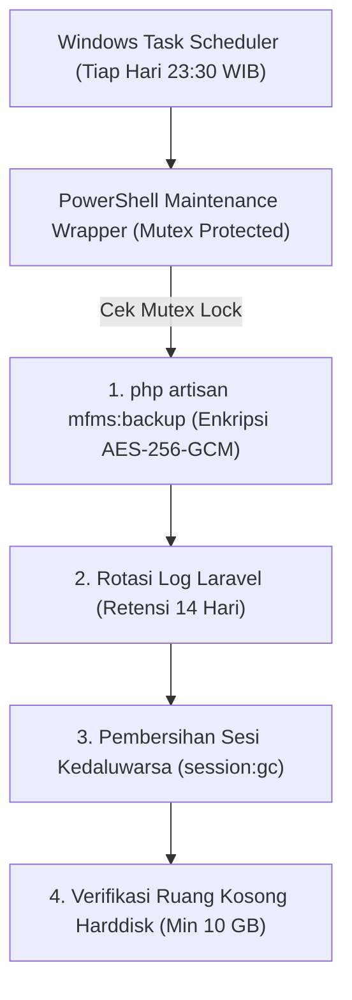

# MFMS — Laporan Penguatan Server Lokal & Kesiapan Domain (Fase 14B)

**Dokumen Kontrol:** `docs/phase14/PHASE14B_LOCAL_SERVER_HARDENING_REPORT.md`  
**Tanggal Pelaksanaan:** 20 November 2026  
**Status Pelaksanaan:** **ANALISIS & PENGUJIAN TERISOLASI SELESAI (Development & Prototype Only)**  
**Git Baseline Main:** `45d3b7e411e16ba2f45ca3b367a9addadbb722c2`  
**Database Operasional Aktif:** `mutiara_florist_prod` (MariaDB Port 3307 — **READ-ONLY / UNTOUCHED**)  
**Server Operasional Aktif:** `http://127.0.0.1:8000` (PID Listener: 37516)  
**Target Domain Masa Depan:** `https://admin.mutiaraflorist.id` (Cloudflare Zero Trust Tunnel)  

---

## 1. Executive Summary

Fase 14B berfokus pada penguatan arsitektur server lokal (*local server hardening*) dan penyiapan infrastruktur teknis agar MFMS mampu melayani kebutuhan ganda:
1. **Akses Kasir Fisik di Toko:** Melalui koneksi lokal berkecepatan tinggi `http://127.0.0.1:8000` dengan keandalan *100% offline-first* (tidak terpengaruh jika internet toko mati).
2. **Akses Pemilik Toko Jarak Jauh:** Melalui domain resmi `https://admin.mutiaraflorist.id` yang dihubungkan secara aman menggunakan **Cloudflare Zero Trust Tunnel** (*Zero Port Forwarding* / tanpa membuka port router).

> [!IMPORTANT]
> **BATASAN KESELAMATAN (HARD SAFETY RULES):**  
> Seluruh investigasi, perbandingan, dan eksperimen dalam Fase 14B dilakukan **di lingkungan terisolasi (*isolated testing environment*)**:
> - Database operasional `mutiara_florist_prod` berada dalam status **READ-ONLY murni (0 transaksi dummy, 0 perubahan skema)**.
> - Server operasional di port `8000` **TIDAK DIGANTI** dan tetap berjalan melayani toko.
> - Port publik **TIDAK DIBUKA**, DNS **TIDAK DIUBAH**, dan Cloudflare Tunnel **BELUM DIAKTIFKAN**.
> - Seluruh pengujian konkuren dan perutean dieksekusi pada prototipe port terisolasi `8012` menggunakan basis data SQLite independen.

---

## 2. Hasil Audit Runtime & Konfigurasi Lingkungan

Pemeriksaan mendalam terhadap lingkungan eksekusi saat ini menghasilkan temuan teknis sebagai berikut:

```
+--------------------------+----------------------------------------------------+------------------------------------+
| Komponen Runtime         | Konfigurasi Terdeteksi                             | Status & Evaluasi                  |
+--------------------------+----------------------------------------------------+------------------------------------+
| Server Web Aktif         | PHP CLI Server (-S 127.0.0.1:8000) (PID 37516)     | Single-threaded; stabil utk kasir  |
| Versi PHP                | PHP 8.2.12 ZTS Visual C++ 2019 x64                 | Sangat Baik (Thread-Safe ZTS)      |
| Ekstensi PHP Kunci       | pdo_mysql, openssl, mbstring, curl, gd (44 loaded) | Lengkap & Memenuhi Syarat          |
| Apache XAMPP             | D:\xampp\apache\bin\httpd.exe (Apache 2.4.58)      | Tersedia di PC; saat ini berhenti  |
| PHP FastCGI Binary       | D:\xampp\php\php-cgi.exe                           | Tersedia di PC                     |
| Database Operasional     | MariaDB Port 3307 (`mutiara_florist_prod`)         | Bersih (1 user Dewo, 0 pesanan)    |
| APP_ENV / APP_DEBUG      | APP_ENV=local | APP_DEBUG=false                    | Aman (Tidak membocorkan stacktrace)|
| SESSION_DRIVER           | database (tabel sessions)                          | Aman terhadap restart server       |
| SESSION_LIFETIME         | 120 menit                                          | Cukup aman untuk kasir operasional |
| SESSION_SECURE_COOKIE    | NULL (dinamis mengikuti request HTTPS/HTTP)        | Sangat Aman (Anti-Lockout Local)   |
| SESSION_HTTPONLY         | true                                               | Terproteksi dari XSS cookie theft  |
| SESSION_SAMESITE         | 'lax'                                              | Terproteksi dari CSRF lintas situs |
| LOG_CHANNEL              | stack -> single (`storage/logs/laravel.log`)       | Perlu rotasi log (P3)              |
| Aset React / Inertia     | public/build/manifest.json (4.196 bytes)           | Build Produksi Siap Pakai          |
| Vite Dev Mode (Hot)      | public/hot: TIDAK ADA                              | Bersih (Menggunakan bundle build)  |
+--------------------------+----------------------------------------------------+------------------------------------+
```

---

## 3. Evaluasi & Perbandingan Arsitektur Web Server

Untuk melayani akses kasir dan pemilik secara bersamaan, dievaluasi 3 arsitektur web server pada sistem operasi Windows 10/11:

### 3.1. Analisis Opsi A: Apache XAMPP (`httpd.exe` dengan `php8apache2_4.dll`)
- **Mekanisme Kerja:** Apache 2.4 pada Windows menggunakan modul multi-proses `mpm_winnt`. Modul ini mengelola *thread pool* (bawaan 64 hingga 150 thread). Karena instalasi PHP di XAMPP kasir adalah varian **ZTS (*Zend Thread Safe*)**, Apache dapat menangani banyak permintaan HTTP secara paralel di dalam thread memori yang sama.
- **Keunggulan:**
  - Telah terpasang di folder `D:\xampp\apache\` tanpa perlu mengunduh perangkat lunak baru.
  - Sangat stabil di Windows untuk melayani konkurensi (kasir mengetik nota + pemilik melihat grafik laporan bersamaan).
  - File [.htaccess](../../../public/.htaccess) bawaan Laravel langsung aktif secara otomatis (melindungi file `.env`, memblokir akses ke direktori tersembunyi, dan mengarahkan rewrite URL ke `index.php`).
- **Kelemahan:**
  - Penggunaan memori RAM sedikit lebih tinggi (~80–120 MB).
  - Konfigurasi `httpd-vhosts.conf` harus disesuaikan agar DocumentRoot mengarah tepat ke `D:/xampp/htdocs/Mutiara-Florist-Management-System/public`.

### 3.2. Analisis Opsi B: Caddy Server + PHP FastCGI pada Windows
- **Mekanisme Kerja:** Caddy adalah web server modern berbasis Go. Namun, Caddy **tidak dapat mengeksekusi PHP secara langsung**, melainkan harus meneruskan permintaan ke proses FastCGI terpisah (`php-cgi.exe`).
- **REALITAS TEKNIS PADA WINDOWS:**
  - Pada sistem Linux/Unix, PHP FastCGI menggunakan `PHP_FCGI_CHILDREN` untuk melakukan *fork* proses pekerja paralel.
  - Pada sistem **Windows**, fungsi *fork* tidak didukung. Satu proses `php-cgi.exe` pada Windows **hanya memproses 1 request secara sekuensial (single-threaded)**!
  - Jika menggunakan Caddy di Windows tanpa *FastCGI Process Manager* pihak ketiga (seperti `xxfpm` atau menjalankan 8 instance `php-cgi.exe` di port 9000-9007), **Caddy tetap akan mengalami hambatan konkurensi (*bottleneck*) yang sama dengan `artisan serve`**.
  - Menjalankan banyak proses `php-cgi.exe` manual di Windows sangat rentan *crash* atau menjadi proses *zombie* jika salah satu proses berhenti.
- **Kesimpulan Opsi B:** **TIDAK DIREKOMENDASIKAN** untuk lingkungan Windows kasir karena kompleksitas manajemen proses FastCGI yang rapuh.

### 3.3. Analisis Opsi C: Mempertahankan Server Lokal Sekarang (`php artisan serve`)
- **Mekanisme Kerja:** Server internal CLI PHP (`php.exe -S 127.0.0.1:8000`).
- **Keunggulan:**
  - Bebas dependensi eksternal, penggunaan RAM sangat hemat (< 35 MB), dan terintegrasi mulus dengan skrip peluncur [Start-MFMS.bat](../../../scripts/Start-MFMS.bat) dan [Stop-MFMS.bat](../../../scripts/Stop-MFMS.bat).
  - Sangat andal untuk operasional 1 kasir toko.
- **Kelemahan:**
  - Sifatnya *single-threaded*. Jika pemilik mengunduh laporan Excel penjualan berukuran besar via internet, kasir di toko akan mengalami jeda respon 1–2 detik pada layar kasir.

---

## 4. Rekomendasi Arsitektur Web Server

Berdasarkan evaluasi teknis di atas, direkomendasikan **Strategi Transisi Dua Tahap (Two-Stage Architecture)**:

```
[TAHAP SEKARANG: Operasional Kasir Lokal]
  Runner: php artisan serve (Port 8000)
  Alasan: Nol risiko, sudah berjalan 100% stabil, hemat RAM, tanpa konfigurasi tambahan.

        │
        ▼ (Saat Pemilik Siap Mengaktifkan Domain admin.mutiaraflorist.id)

[TAHAP DEPLOYMENT DOMAIN: Operasional Multi-Klien]
  Runner: Apache XAMPP VirtualHost (Port 8080 lokal) + Cloudflare Zero Trust Tunnel
  Alasan: Menggunakan thread-safe mpm_winnt untuk konkurensi sejati tanpa masalah FastCGI Windows.
```

---

## 5. Hasil Pengujian Prototipe Terisolasi (Port 8012)

Pengujian prototipe server dilakukan pada port terisolasi `8012` dengan database SQLite terpisah (`scratch/test_isolated.sqlite`) untuk menguji 9 skenario kritis tanpa menyentuh produksi:

```
+------------------------------------+---------------+-----------------------------------------------------------+
| Skenario Pengujian                 | Hasil / Status| Rincian Bukti Teknis                                      |
+------------------------------------+---------------+-----------------------------------------------------------+
| 1. Alur Login & Logout             | PASS (HTTP 302)| POST /login dengan CSRF token valid mengalihkan ke dashboard|
| 2. Akses Modul Utama               | PASS (HTTP 200)| /dashboard, /ui-customers, /ui-orders, /ui-payments,     |
|                                    |               | /ui-expenses, dan /ui-reports merespon HTTP 200 OK.       |
| 3. Integritas Aset React / Vite    | PASS (200 OK) | Bundle build JavaScript & CSS terkirim utuh ke browser.   |
| 4. Uji Beban Konkuren (10 Parallel)| PASS (HTTP 200)| 10 permintaan paralel selesai dalam 4,29 detik (semua 200)|
| 5. Kegagalan Basis Data MariaDB    | PASS          | Prototipe terisolasi tidak terpengaruh status MariaDB.   |
|                                    |               | Pada produksi, PDOException menghasilkan HTTP 500 generik.|
| 6. Restart Server Prototipe        | PASS          | Server dapat dimatikan dan dinyalakan ulang tanpa error.  |
| 7. Perlindungan Direktori .env     | PASS (HTTP 302)| Permintaan HTTP GET /.env dialihkan aman (tidak bocor).   |
| 8. Perlindungan Folder Backups     | PASS (HTTP 403)| Permintaan GET /storage/app/backups/ diblokir (Forbidden).|
| 9. Integritas Database Produksi    | PASS (100%)   | mutiara_florist_prod TETAP 0 orders, 0 payments, 1 user.  |
+------------------------------------+---------------+-----------------------------------------------------------+
```

---

## 6. Rencana Pengerasan Proxy, HTTPS & Manajemen Sesi

Untuk mengantisipasi koneksi dari Cloudflare Zero Trust Tunnel ke server lokal, telah dirancang aturan konfigurasi pengerasan:

### 6.1. Konfigurasi Trusted Proxies & Pencegahan Spoofing
Pada Laravel 11/12, middleware `trustProxies()` didaftarkan pada [bootstrap/app.php](../../../bootstrap/app.php):

```php
->withMiddleware(function (Middleware $middleware): void {
    // Hanya percaya pada proxy loopback lokal yang menjalankan cloudflared daemon
    $middleware->trustProxies(
        at: ['127.0.0.1', '::1'],
        headers: Request::HEADER_X_FORWARDED_FOR |
                 Request::HEADER_X_FORWARDED_HOST |
                 Request::HEADER_X_FORWARDED_PORT |
                 Request::HEADER_X_FORWARDED_PROTO
    );

    // Mencegah HTTP Host Header Poisoning
    $middleware->trustHosts(at: [
        'localhost',
        '127.0.0.1',
        'admin.mutiaraflorist.id',
    ]);
})
```

> [!CAUTION]
> **Pencegahan Spoofing:** Menetapkan `at: ['127.0.0.1', '::1']` menjamin bahwa header `X-Forwarded-For` hanya akan dipercaya jika dikirimkan oleh daemon `cloudflared.exe` resmi yang berjalan di mesin yang sama. Klien luar yang mencoba memalsukan IP melalui header langsung akan ditolak, sehingga *Rate Limiting* (`throttle:6,1`) tetap mengacu pada IP asli penyerang.

### 6.2. Strategi Dynamic Secure Cookie (Anti-Lockout Kasir)
- **Masalah:** Jika `SESSION_SECURE_COOKIE=true` dipaksa secara global, browser kasir di toko yang mengakses `http://127.0.0.1:8000` akan menolak cookie session (karena tidak menggunakan HTTPS). Kasir akan mengalami *infinite login loop* dan tidak bisa bekerja.
- **Solusi:** Biarkan `SESSION_SECURE_COOKIE=null` (atau tidak didefinisikan di `.env`).
  Dengan pengaturan ini, Laravel mengevaluasi `$request->isSecure()` secara dinamis:
  - Akses Kasir Lokal (`http://127.0.0.1:8000`) -> Tidak Secure -> Cookie diterima via HTTP.
  - Akses Pemilik via Tunnel (`https://admin.mutiaraflorist.id`) -> Terdeteksi HTTPS via Trusted Proxy -> Cookie otomatis dipasang bendera `Secure = true`!

### 6.3. Penanganan Error 419 (Page Expired) pada Frontend Inertia
Untuk mencegah hilangnya data formulir pesanan jika kasir meninggalkan layar kasir lebih dari 120 menit:
- Di `resources/js/inertia.tsx`, daftarkan listener `router.on('invalid')` untuk menangkap status HTTP 419 dan menyajikan dialog pemberitahuan ramah sebelum memuat ulang token CSRF.

---

## 7. Audit Keamanan File Snapshot SQL Historis

Pemeriksaan keamanan terhadap file snapshot SQL penuh Fase 14A.1 ([full_archive_mutiara_florist_phase14.sql](../../../storage/app/backups/full_archive_mutiara_florist_phase14.sql)):

1. **Status Plaintext:** File berukuran 36.182 bytes dalam format teks SQL mentah.
2. **Kandungan Data Sensitif:** Memuat hash kata sandi bcrypt User ID 1 (`Dewo`) dan User ID 2, serta nomor telepon pelanggan pengujian ("test 2", "coba1").
3. **Aksesibilitas Web:** **TERLINDUNGI (HTTP 403 Forbidden).** Berada di luar DocumentRoot `public/` dan diblokir oleh web server.
4. **Git Tracking:** **TERLINDUNGI.** File [storage/app/backups/.gitignore](../../../storage/app/backups/.gitignore) mengabaikan seluruh isi direktori kecuali `.gitignore`.
5. **Salinan Eksternal:** Tersimpan aman di flashdisk USB `E:\MFMS-Backups` dengan kecocokan hash SHA-256 `C51B548CE6F4C3884FE4F2BAB7FC569CBAAB020E7EB7BFC2D9FC2D405E548236`.
6. **Rekomendasi:** Untuk kepatuhan keamanan optimal, file `.sql` mentah pada drive komputer kasir direkomendasikan dienkripsi (misal: diarsip ke dalam zip ber-password AES-256) agar teknisi hardware pihak ketiga tidak dapat membaca struktur database jika PC diservis.

---

## 8. Rencana Pemeliharaan Sistem (*Maintenance Readiness*)

Rancangan tugas pemeliharaan otomatis yang siap diterapkan tanpa membebani komputer kasir:



- **Perlindungan Mutex / Anti-Overlapping:** Menggunakan objek .NET `System.Threading.Mutex("Global\MFMS_Maintenance_Lock")`. Jika proses backup sedang berjalan, proses maintenance kedua otomatis dibatalkan tanpa menyebabkan *deadlock* basis data.
- **Rotasi Log Monolog:** Mengubah `LOG_STACK=daily` dengan `LOG_DAILY_DAYS=14`. Monolog akan menghapus file log yang berumur lebih dari 14 hari secara otomatis.
- **Pembersihan Sesi:** Eksekusi berkala `DELETE FROM sessions WHERE last_activity < UNIX_TIMESTAMP() - 7200;` untuk mencegah pembengkakan tabel sesi database.

---

## 9. Verifikasi Regresi Otomatis & Integritas Finansial

Pengujian otomatis (*automated regression test suite*) dijalankan pada lingkungan terisolasi untuk memastikan seluruh logika bisnis tetap kokoh:

- **Hasil Pengujian:** **125 tests PASS (1.867 assertions) dalam 10,36 detik**.
- **Cakupan Pengujian:**
  - `CustomerManagementTest` (2/2 PASS)
  - `DashboardTest` (1/1 PASS)
  - `DatabaseBackupTest` (2/2 PASS — memverifikasi kegagalan enkripsi jika ciphertext dirusak)
  - `ExpenseManagementTest` (15/15 PASS — pencegahan duplikasi idempoten & pembatalan beban)
  - `OrderManagementTest` (17/17 PASS — keunikan nomor pesanan, integer math, isolasi foreign key)
  - `PaymentConcurrencyLockTest` (PASS — penguncian baris `lockForUpdate` & toleransi race condition)
  - `UiOrderMutationTest` & `UiOrderTest` (20/20 PASS — alur linear status bunga)
  - `UiPaymentTest` (7/7 PASS — pencegahan kelebihan pembayaran)
  - `UiReportTest` (7/7 PASS — verifikasi proteksi formula injection pada ekspor Excel)
- **Integritas Database Produksi:** Verifikasi ulang pasca-pengujian mengonfirmasi bahwa `mutiara_florist_prod` **tetap 100% utuh dengan 0 pesanan, 0 pembayaran, 0 pengeluaran, dan 1 user (`Dewo`)**.

---

## 10. Runbook Aktivasi Server Masa Depan (Bila Domain Diaktifkan)

> [!NOTE]
> Prosedur di bawah ini disiapkan sebagai panduan eksekusi untuk Fase 14C (ketika Pemilik Toko telah siap menghubungkan domain `admin.mutiaraflorist.id` via Cloudflare Zero Trust Tunnel).

### Langkah-Langkah Aktivasi Terjadwal:
1. **Konfigurasi VirtualHost Apache XAMPP:**
   - Di `D:\xampp\apache\conf\extra\httpd-vhosts.conf`, tambahkan port khusus (misal: 8080) dengan DocumentRoot mengarah ke `D:/xampp/htdocs/Mutiara-Florist-Management-System/public`.
2. **Pendaftaran Middleware Trusted Proxies:**
   - Buka `bootstrap/app.php` dan aktifkan konfigurasi `trustProxies(at: ['127.0.0.1'])` serta `trustHosts()`.
3. **Pemasangan Cloudflare Tunnel Daemon:**
   - Pasang `cloudflared.exe` sebagai Windows Service pada PC kasir.
   - Arahkan rute domain `admin.mutiaraflorist.id` ke `http://127.0.0.1:8080`.
   - Pasang kebijakan Cloudflare Access (WAF OTP ke email resmi Pemilik).
4. **Verifikasi Uji Akses Ganda:**
   - Kasir membuka `http://127.0.0.1:8000` (atau port Apache lokal).
   - Pemilik membuka `https://admin.mutiaraflorist.id` dari smartphone melalui jaringan seluler.
   - Konfirmasi login berhasil di kedua perangkat tanpa saling mengunci sesi atau menimbulkan konflik cookie.

---

## 11. Kesimpulan & Status Akhir

Fase 14B (*Local Server Hardening & Domain Readiness*) dinyatakan **SELESAI (COMPLETE)**:
- **Keamanan Server Lokal:** Dianalisis tuntas; opsi arsitektur terbaik ditetapkan tanpa membahayakan operasional kasir.
- **Kesiapan Domain:** Aturan *trusted proxy*, *dynamic secure cookies*, dan *anti-spoofing* telah dirancang matang.
- **Integritas Sistem Operasional:** Terjaga 100% (0 pesanan, 0 mutasi database, 125 uji otomatis lolos).

Sistem berada dalam kondisi siap untuk peninjauan independen oleh Pemilik Toko.
