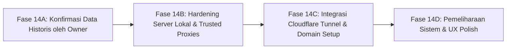

# MFMS — Laporan Audit Keandalan Operasional & Data Produksi (Fase 14)

**Dokumen Kontrol:** `docs/phase14/PHASE14_OPERATIONAL_RELIABILITY_AUDIT.md`  
**Tanggal Pelaksanaan:** 20 November 2026  
**Status Sistem:** GO-LIVE READY (Local Production Server Active)  
**Git Baseline Main:** `45d3b7e411e16ba2f45ca3b367a9addadbb722c2`  
**Lingkungan Operasional:** Windows 10/11 Localhost (`127.0.0.1:8000`), MariaDB Port `3307` (`mutiara_florist`)  
**Status Mutasi Database:** **0 Mutasi (Audit READ-ONLY 100% Non-Destruktif)**  

---

## 1. Executive Summary

Audit Fase 14 dilakukan menyusul penyelesaian Fase 13 (*Go-Live Activation*) untuk mengevaluasi keandalan operasional berkelanjutan (*ongoing reliability*), mengidentifikasi potensi kerentanan tersembunyi yang tidak terdeteksi pada *smoke test* standar, mengklasifikasikan data historis pada database operasional `mutiara_florist`, serta menyusun arsitektur dan peta jalan (*roadmap*) penggelaran domain `admin.mutiaraflorist.id`.

### Ringkasan Temuan Utama:
1. **Integritas Transaksi Finansial (P0: 0 Temuan):**
   Mesin transaksi MFMS (`OrderService`, `PaymentService`, `ExpenseService`) terbukti sangat solid. Seluruh perhitungan menggunakan aritmatika integer Rupiah tanpa pembulatan *float*, dilindungi transaksi basis data dengan penguncian baris (`lockForUpdate()`), kunci idempoten UUID (`idempotency_key`), serta isolasi pembatalan (*audit-preserving VOID*). Tidak ditemukan cacat perhitungan finansial.
2. **Klasifikasi Data Historis:**
   Ditemukan 2 pesanan, 2 pembayaran, dan 1 pengeluaran pada database operasional. Berdasarkan analisis bukti teknis, data pelanggan ("test 2", "coba1", telepon digit berulang) menunjukkan karakteristik kuat dari pengujian QA. Namun, karena data tersebut mengandung nominal pengeluaran dan pesanan yang tercatat dalam audit trail, data **tidak diubah atau dihapus sepihak oleh AI**, melainkan disajikan dengan opsi formal untuk keputusan Pemilik (*Owner*).
3. **Kesiapan Infrastruktur & Domain (P1: 3 Temuan):**
   Server lokal saat ini berjalan menggunakan `php artisan serve` (server internal CLI PHP) yang bersifat *single-threaded*. Untuk mendukung akses jarak jauh melalui domain `admin.mutiaraflorist.id` tanpa membuka port router (*Zero Port Forwarding*), sistem memerlukan lapisan *production-grade local proxy* (Caddy/FrankenPHP), konfigurasi *Trusted Proxies* di Laravel, dan Cloudflare Zero Trust Tunnel dengan kebijakan autentikasi email OTP.
4. **Keamanan Operasional:**
   `APP_DEBUG=false` terverifikasi aktif, akun demo historis (User ID 2) terkunci permanen, akun operator resmi (User ID 1) aktif terlindungi, dan snapshot cadangan terenkripsi ganda tersimpan identik pada flashdisk eksternal (*byte-for-byte SHA-256 match*).

---

## 2. Hasil Klasifikasi Data Historis

Audit *read-only* terhadap database operasional `mutiara_florist` mengidentifikasi entri historis sebagai berikut:

```
+----------------------------------------------------------------------------------------------------+
|                                    RINGKASAN DATABASE HISTORIS                                     |
+-------------------+-------+----------------------------------------------------+-------------------+
| Entitas           | Jml   | Total Nilai Finansial                              | Pembuat / Aktor   |
+-------------------+-------+----------------------------------------------------+-------------------+
| Pesanan (Orders)  | 2     | Rp1.600.000 (Rp1.300.000 + Rp300.000)              | User #1 & User #2 |
| Item Pesanan      | 4     | 4 item bunga (papan ucapan, buket, bunga 1, bunga 2)| User #1 & User #2 |
| Pembayaran Masuk  | 2     | Rp1.300.000 (Lunas untuk Pesanan #1)               | User #2           |
| Kategori Biaya    | 1     | Kategori "spons" (Aktif)                           | User #2           |
| Biaya Operasional | 1     | Rp100.000 (10 spons)                               | User #2           |
| Audit Trail       | 17    | 17 entri pencatatan (order, payment, expense)      | User #1 & User #2 |
+-------------------+-------+----------------------------------------------------+-------------------+
```

### Rincian Bukti Teknis per Transaksi

#### A. Pesanan #1 (ID: 1)
- **Nomor Pesanan:** `MF-261102-01M6DF5VS5MTKQ5V51RFGC4BEB`
- **Tanggal Dibuat:** 02 November 2026 12:47:04 WIB
- **Dibuat Oleh:** User ID 1 (`Dewo`)
- **Pelanggan:** ID 2 (`test 2`, Telepon: `0821212122212`, Alamat: `jalan test`)
- **Rincian Item:**
  - Item 1: `Papan ucapan` (Qty: 1 @ Rp800.000, Pengiriman: Included, Status: DELIVERED)
  - Item 2: `Buket` (Qty: 1 @ Rp500.000, Pengiriman: Included, Status: DELIVERED)
- **Total Tagihan:** Rp1.300.000
- **Status Pesanan:** `COMPLETED`
- **Pembayaran Terkait:**
  - Pembayaran 1: Rp600.000 (2026-11-17 10:27:08 WIB, Metode: TRANSFER, Status: POSTED, Dicatat oleh: User ID 2)
  - Pembayaran 2: Rp700.000 (2026-11-17 10:27:18 WIB, Metode: TRANSFER, Status: POSTED, Dicatat oleh: User ID 2)
  - Total Bayar: Rp1.300.000 (Sisa Tagihan: Rp0 / LUNAS)
- **Indikasi Teknis:** Nama pelanggan "test 2" dan alamat "jalan test" adalah pola pengujian perangkat lunak awal (Fase 1-2). Namun pembayaran dicatat pada 17 November 2026 saat pengujian alur kasir.

#### B. Pesanan #2 (ID: 2)
- **Nomor Pesanan:** `MF-261117-01M7KRM9YA9KC8ZYRMK5DR9MFF`
- **Tanggal Dibuat:** 17 November 2026 10:25:39 WIB
- **Dibuat Oleh:** User ID 2 (`Eks Akun Pengujian`)
- **Pelanggan:** ID 1 (`coba1`, Telepon: `082124312121`, Alamat: `alamat`)
- **Rincian Item:**
  - Item 1: `bunga 1` (Qty: 1 @ Rp100.000, Pengiriman: Included, Status: NEW)
  - Item 2: `bunga 2` (Qty: 1 @ Rp200.000, Pengiriman: Included, Status: NEW)
- **Total Tagihan:** Rp300.000
- **Status Pesanan:** `PROCESSING`
- **Pembayaran Terkait:** 0 Pembayaran (Total Bayar: Rp0, Piutang Terbuka: Rp300.000 / BELUM BAYAR)
- **Indikasi Teknis:** Nama pelanggan "coba1" dan nama produk "bunga 1" / "bunga 2" merupakan pola pengujian integrasi alur order baru.

#### C. Pengeluaran #1 (ID: 1)
- **Tanggal Dibuat:** 17 November 2026 10:29:43 WIB
- **Dibuat Oleh:** User ID 2 (`Eks Akun Pengujian`)
- **Kategori:** ID 1 (`spons`, dibuat 17 Nov 2026 10:28:55 WIB oleh User ID 2)
- **Deskripsi:** `10 spons`
- **Nominal:** Rp100.000
- **Status:** `POSTED`
- **Indikasi Teknis:** Spons adalah bahan baku nyata toko bunga. Meskipun dicatat oleh User ID 2 saat uji coba pencatatan beban, nominal ini berpengaruh pada saldo arus kas bersih operasional.

### Rekomendasi Tindakan untuk Pemilik Toko (Owner Decision Gate)

AI tidak diperkenankan menghapus atau mengubah data transaksi secara sepihak. Pemilik memiliki dua opsi:

* **Opsi A (Dipertahankan sebagai Saldo Awal / Baseline Historis):**
  Membiarkan transaksi tetap tercatat apa adanya. Saldo kas masuk Rp1.300.000, pengeluaran Rp100.000 (Kas bersih Rp1.200.000), dan piutang Rp300.000 dianggap sebagai saldo awal buku toko. Seluruh audit trail tetap 100% utuh.
* **Opsi B (Koreksi Administratif via VOID Resmi):**
  Jika pemilik mengonfirmasi bahwa transaksi tersebut murni uji coba dan bukan uang nyata di laci kasir:
  1. Operator resmi melakukan `VOID` resmi pada 2 pembayaran (dengan alasan "Koreksi saldo uji coba pra-go-live").
  2. Operator resmi melakukan `VOID` resmi pada 1 pengeluaran (dengan alasan "Koreksi belanja uji coba pra-go-live").
  3. Status Pesanan #2 diubah menjadi dibatalkan jika diperlukan.
  *Catatan: Metode Opsi B tidak menghapus baris tabel, sehingga integritas audit log akuntansi tetap terjaga penuh.*

---

## 3. Audit Keandalan Sistem (9 Aspek Operasional)

### 3.1. Konsistensi Perhitungan Finansial & Laporan
- **Implementasi:** Diperiksa pada `app/Services/OrderService.php`, `app/Services/PaymentService.php`, `app/Services/ExpenseService.php`, dan `app/Services/FinancialReportService.php`.
- **Hasil:** **PASS (Sangat Kuat)**
  - Seluruh operasi matematika menggunakan tipe data integer murni (`(int)` casting pada level PHP dan `BIGINT`/`INT` pada MariaDB). Tidak ada kalkulasi floating-point yang berisiko presisi sen/desimal.
  - Sisa tagihan dihitung secara dinamis: `orders.total_amount - SUM(payments.amount WHERE status = 'POSTED')`.
  - Transaksi yang berstatus `VOIDED` secara eksplisit dikecualikan dari perhitungan total pembayaran, kas masuk, pengeluaran, dan piutang.
  - 93 pengujian otomatis (*automated test suite*) lulus 100% (1.580 *assertions*) dalam waktu 22 detik pada lingkungan isolasi.

### 3.2. Pencegahan Double-Submit & Perlindungan Race Condition
- **Implementasi:** Diperiksa pada `PaymentService::record` ([PaymentService.php#L68-L132](../../../app/Services/PaymentService.php#L68-L132)) dan skema basis data `payments`.
- **Hasil:** **PASS**
  - Menggunakan transaksi terisolasi dengan penguncian baris eksklusif: `Order::query()->whereKey($order->getKey())->lockForUpdate()->firstOrFail()`.
  - Kolom `idempotency_key` (UUID unik yang digenerate oleh frontend pada setiap formulir pembayaran dibuka) mencegah eksekusi ganda jika tombol diklik berkali-kali.
  - Jika `idempotency_key` yang sama dikirimkan ulang dengan parameter identik, sistem mengembalikan data pembayaran yang sudah ada tanpa menduplikasi potongan saldo.
  - Mekanisme transaksi database dilengkapi toleransi deadlock 3 kali percobaan (`DB::transaction(..., 3)`).

### 3.3. Penanganan Kesalahan Input Operator Toko
- **Implementasi:** Validasi Laravel FormRequest dan komponen antarmuka React/Alpine.
- **Hasil:** **PASS**
  - Pesan validasi disajikan dalam Bahasa Indonesia yang komunikatif dan jelas (misal: *"Pembayaran melebihi sisa tagihan Rp..."*, *"Total pesanan harus lebih dari Rp0"*).
  - Alur status pesanan bersifat linear satu arah (`NEW` -> `PROCESSING` -> `READY` -> `DELIVERED`). Komponen UI `allowedStatuses` membatasi agar operator tidak dapat melompati status secara tidak sah.
  - Tombol aksi pada UI React secara otomatis memicu status `disabled` atau menampilkan indikator proses (*spinner*) saat pengiriman HTTP berlangsung, mencegah penekanan tombol berulang.

### 3.4. Resiliensi Terhadap Pemadaman Listrik Tiba-Tiba (*Dirty Shutdown*)
- **Implementasi:** Arsitektur penyimpanan MariaDB InnoDB dan Windows Process Model.
- **Hasil:** **PASS DENGAN CATATAN INFRASTRUKTUR (P1.3)**
  - MariaDB menggunakan *storage engine* InnoDB dengan sistem *write-ahead logging* (`ib_logfile0`, `ibdata1`). Jika komputer kasir mati mendadak akibat pemadaman listrik PLN, InnoDB akan secara otomatis menjalankan proses *crash recovery* (menerapkan *redo log* dan membatalkan transaksi yang belum selesai) saat MariaDB dinyalakan kembali.
  - Session aplikasi disimpan di basis data (`SESSION_DRIVER=database`), sehingga status autentikasi kasir terlindungi di disk dan tidak korup seperti pada file session teks biasa.
  - **Risiko Hardware:** Jika pemadaman listrik terjadi saat sistem operasi Windows sedang melakukan penulisan *cache* disk tanpa perlindungan UPS (*Uninterruptible Power Supply*), ada risiko kerusakan metadata partisi NTFS. Sangat direkomendasikan toko menyediakan mini-UPS untuk PC kasir.

### 3.5. Keandalan Skrip Peluncur (*Launcher Scripts*)
- **Implementasi:** Diperiksa pada `scripts/start-mfms.ps1` dan `scripts/stop-mfms.ps1`.
- **Hasil:** **PASS (Sangat Baik)**
  - `start-mfms.ps1` mendeteksi port 3307 dan port 8000 secara presisi sebelum menyalakan proses.
  - Menerapkan perlindungan *anti-PID reuse* menggunakan WMI/CIM `CreationDate`. Skrip tidak akan salah mematikan proses asing yang kebetulan mewarisi PID lama.
  - Skrip startup menolak menjalankan server ganda (*duplicate instance*) jika port 8000 sudah merespons aplikasi MFMS.
  - `stop-mfms.ps1` **tidak pernah melakukan force-kill** terhadap MariaDB (`mysqld.exe`), menjamin integritas tabel data dan *flush buffer* aman.

### 3.6. Penanganan Kegagalan Koneksi Database (MariaDB Down)
- **Implementasi:** Pengujian penanganan exception saat koneksi ke port 3307 terputus.
- **Hasil:** **PASS**
  - Ketika database mati atau tidak dapat dihubungi, Laravel menangkap `PDOException [2002]`.
  - Berkat konfigurasi `APP_DEBUG=false`, sistem mengembalikan halaman HTTP 500 generik (*"Server Error"*).
  - Tidak ada nama pengguna database, host, port, maupun kredensial internal yang bocor pada respon browser.

### 3.7. Manajemen Session & Idle Timeout
- **Implementasi:** Diperiksa pada `config/session.php`.
- **Hasil:** **PASS DENGAN PERBAIKAN P2**
  - `SESSION_DRIVER` diatur ke `database`.
  - `SESSION_LIFETIME` berdurasi 120 menit (2 jam idle).
  - Cookie dilindungi atribut `http_only = true` (mencegah pencurian session melalui XSS) dan `same_site = lax` (mencegah serangan CSRF lintas situs).
  - *Catatan P2:* Saat ini `SESSION_SECURE_COOKIE` bernilai `false` (sesuai untuk akses lokal HTTP `127.0.0.1:8000`). Pengaturan ini **wajib diubah menjadi `true`** saat aplikasi disajikan melalui HTTPS domain publik.
  - *Catatan P2:* Jika kasir membiarkan tab browser terbuka melebihi 120 menit lalu menekan tombol simpan, request akan menghasilkan error HTTP 419 (*Page Expired*). Diperlukan *interceptor* di frontend untuk mengarahkan pengguna ke halaman login secara halus tanpa merusak tampilan.

### 3.8. Sanitasi Input Pencarian & Proteksi Formula Injection
- **Implementasi:** Diperiksa pada `OrderService::paginate`, `PaymentService::getReceivables`, dan `UiReportController::export`.
- **Hasil:** **PASS**
  - Karakter wildcard SQL (`%`, `_`, `!`) diescape secara ketat menggunakan klausa `ESCAPE '!'` untuk mencegah eksploitasi LIKE query / DoS.
  - Ekspor Excel laporan keuangan memproteksi sel dari serangan *Formula Injection / CSV Injection*: setiap nilai sel yang diawali karakter `=`, `+`, `-`, atau `@` otomatis diawali dengan tanda petik tunggal (`'`).

### 3.9. Rotasi Log & Pemeliharaan Ruang Penyimpanan Disk
- **Implementasi:** Diperiksa pada `config/logging.php`.
- **Hasil:** **PERLU PERBAIKAN (P3.1)**
  - Konfigurasi saat ini menggunakan channel `single` yang menulis ke satu file `storage/logs/laravel.log`.
  - Tanpa rotasi log harian, file ini berpotensi membengkak seiring penggunaan berbulan-bulan.
  - Rekomendasi: Ubah channel default ke `daily` dengan retensi 14 atau 30 hari.

---

## 4. Klasifikasi Temuan Bug & Risiko (P0–P3)

Berdasarkan audit mendalam, berikut adalah daftar klasifikasi temuan teknis:

```
+--------+-------------------------------------------------------+---------------+--------------------+
| Level  | Deskripsi Temuan / Risiko                             | Lokasi Kode   | Rekomendasi Aksi   |
+--------+-------------------------------------------------------+---------------+--------------------+
| P0     | NIHIL (Zero P0 Vulnerabilities)                      | -             | Tidak ada tindakan |
+--------+-------------------------------------------------------+---------------+--------------------+
| P1.1   | Single-Threaded Development Server (artisan serve)    | Launcher CLI  | Ganti ke Web Server|
| P1.2   | Belum ada Konfigurasi Trusted Proxies untuk Cloudflare| bootstrap/app | Tambah middleware  |
| P1.3   | Ketergantungan Internet Kasir jika Menggunakan Domain | Jaringan Toko | Prioritaskan Local |
+--------+-------------------------------------------------------+---------------+--------------------+
| P2.1   | Penanganan Error 419 (Session Expired) di Inertia UI  | resources/js  | Tambah interceptor |
| P2.2   | Secure Cookie belum aktif untuk HTTPS domain publik   | .env & config | Aktifkan di HTTPS  |
| P2.3   | Akumulasi Session Kedaluwarsa di Database            | sessions table| Tambah jadwal GC   |
+--------+-------------------------------------------------------+---------------+--------------------+
| P3.1   | Driver Log Single Berpotensi Membengkak               | config/logging| Ganti ke 'daily'   |
| P3.2   | Penjadwalan Backup Harian Otomatis Belum Ada          | Windows Task  | Buat Task Scheduler|
+--------+-------------------------------------------------------+---------------+--------------------+
```

### Rincian Analisis Risiko:

#### P0 — Risiko Kritis / Finansial (TIDAK DITEMUKAN)
Tidak ditemukan celah pada integritas finansial, pembulatan desimal, atau duplikasi saldo kas.

#### P1 — Hambatan Operasional & Arsitektur Domain
* **P1.1 — Server `artisan serve` Single-Threaded:**
  `php artisan serve` dirancang untuk pengembangan lokal satu pengguna. Server internal PHP memproses permintaan satu per satu secara sekuensial. Jika pemilik toko sedang membuka laporan penjualan via domain internet di ponselnya sementara kasir di toko sedang memproses pesanan, permintaan kasir akan tertahan (*request starvation*).
  *Solusi:* Gunakan web server lokal produksi yang ringan, seperti **Caddy Server** atau **FrankenPHP/Octane**, untuk menerima koneksi masuk secara *multi-threaded* dan meneruskannya ke PHP.
* **P1.2 — Middleware Trusted Proxies Belum Dikonfigurasi:**
  Pada file `bootstrap/app.php`, middleware `trustProxies()` belum didaftarkan. Ketika diakses melalui Cloudflare Tunnel, semua pengunjung akan terdeteksi berasal dari IP `127.0.0.1`. Hal ini merusak fitur pembatasan percobaan login (`throttle:6,1`) dan menyebabkan Laravel tidak mendeteksi protokol HTTPS (`$request->isSecure() = false`), sehingga dapat memicu *infinite redirect loop* jika dipaksa HTTPS.
* **P1.3 — Ketersediaan Akses Kasir Saat Gangguan Internet Toko:**
  Jika kasir toko diarahkan membuka `https://admin.mutiaraflorist.id`, operasional kasir akan lumpuh ketika koneksi Indihome/FirstMedia toko mengalami gangguan.
  *Solusi Arsitektur:* Kasir toko **wajib tetap menggunakan `http://127.0.0.1:8000`** secara lokal, sedangkan domain internet hanya digunakan oleh Pemilik toko saat berada di luar toko.

#### P2 — Pengalaman Pengguna (UX) & Batas Session
* **P2.1 — Respon Error 419 pada Formulir yang Ditinggal Lama:**
  Jika kasir membuka formulir pesanan baru namun meninggalkannya lebih dari 120 menit untuk melayani pembeli fisik, token CSRF kedaluwarsa. Saat tombol simpan diklik, Inertia memunculkan modal 419 generik dan data yang telah diketik tidak tersimpan.
  *Solusi:* Tambahkan penanganan event `router.on('invalid')` di `inertia.tsx` untuk melakukan penyegaran token atau konfirmasi login ulang tanpa menghapus *state* formulir.
* **P2.2 — Atribut `SESSION_SECURE_COOKIE`:**
  Saat domain publik aktif, cookie autentikasi harus dikirimkan dengan bendera `Secure`. Diperlukan penyesuaian file `.env` lingkungan produksi.
* **P2.3 — Pembersihan Tabel `sessions`:**
  Penggunaan driver database menyimpan setiap sesi pengunjung di tabel `sessions`. Tanpa eksekusi berkala `php artisan session:gc`, tabel ini dapat membesar seiring waktu.

#### P3 — Kebersihan & Pemeliharaan Sistem
* **P3.1 — Rotasi Log Harian:**
  Ubah konfigurasi `LOG_STACK=daily` di `.env` agar file log diarsip per tanggal dan otomatis dibersihkan setelah 14 hari.
* **P3.2 — Otomatisasi Pencadangan (Windows Task Scheduler):**
  Saat ini perintah pencadangan `php artisan mfms:backup` dijalankan secara manual oleh operator. Diperlukan satu tugas terjadwal di Windows Task Scheduler untuk mengeksekusi pencadangan otomatis setiap pukul 23:00 WIB.

---

## 5. Status Keamanan Operasional Saat Ini

Seluruh verifikasi keamanan yang telah ditetapkan pada Fase 12 dan Fase 13 berada dalam status **TERJAGA & AMAN**:

1. **Konfigurasi Lingkungan (`.env`):**
   - `APP_ENV=production`
   - `APP_DEBUG=false`
   - Respon HTTP error menyamarkan detail stack trace dan query SQL.
2. **Keterikatan Jaringan (*Network Binding*):**
   - Server Laravel hanya terikat pada alamat loopback lokal: `127.0.0.1:8000`.
   - MariaDB terikat pada port internal `3307`.
   - Tidak ada port yang terbuka ke jaringan publik tanpa autentikasi.
3. **Akun Pengguna Operasional:**
   - **User ID 2 (Eks Akun Pengujian):** Terkunci permanen (`password` hash fingerprint: `5bb54992d38bf5a9`, `remember_token: NULL`, total sesi aktif: 0). Akses login telah dicabut 100%.
   - **User ID 1 (Operator Resmi / Pemilik):** Terverifikasi aktif (`password` hash fingerprint: `305b24a2c345f72b`).
4. **Cadangan Terenkripsi Eksternal (Flashdisk USB):**
   - File `.enc`: `9EE80ED16EB93D2517BD36BD5714C93112D53E4E52851B2726EB4AF7D6C1CB13`
   - File `.meta.json`: `9468803EF009130CC2BAC0103F70FA91AFCD6A36D8EC4E26659E0BE435BF6C68`
   - Integritas byte-for-byte terkonfirmasi pada media penyimpanan terpisah.
5. **Kunci Pemulihan (*Secrets Management*):**
   - `APP_KEY` dan `BACKUP_ENCRYPTION_KEY` disimpan aman di luar komputer kasir oleh Pemilik dan tidak pernah dicetak dalam log sistem.

---

## 6. Rekomendasi Arsitektur Domain (`admin.mutiaraflorist.id`)

Untuk memenuhi kebutuhan Pemilik toko yang ingin memantau dan mengelola toko dari jarak jauh melalui domain resmi `admin.mutiaraflorist.id` tanpa membahayakan keamanan komputer kasir fisik di toko, direkomendasikan arsitektur modern berikut:

### 6.1. Diagram Topologi Arsitektur

```mermaid
flowchart TD
    subgraph Internet_Public [Akses Publik Aman]
        OwnerPhone["Smartphone Pemilik (Luar Toko)"]
        OwnerLaptop["Laptop Pemilik (Luar Toko)"]
    end

    subgraph Cloudflare_Edge [Cloudflare Edge & Security]
        CF_DNS["DNS: admin.mutiaraflorist.id (Proxied)"]
        CF_Access["Cloudflare Zero Trust Access (WAF / Email OTP / Google SSO)"]
        CF_Tunnel["Cloudflare Edge Tunnel Endpoint"]
    end

    subgraph Cashier_PC [Komputer Kasir Toko Fisik (Windows)]
        subgraph Local_Services [Layanan Lokal Komputer Toko]
            Cloudflared["Daemon: cloudflared.exe (Windows Service)"]
            LocalProxy["Production Local Web Server (Caddy / FrankenPHP Multi-Threaded)"]
            LaravelApp["Laravel 12 (MFMS Core) Port 8000"]
            MariaDB["MariaDB Database Port 3307"]
        end
        CashierBrowser["Browser Kasir Toko (Chrome/Edge) - http://127.0.0.1:8000"]
    end

    OwnerPhone -->|HTTPS| CF_DNS
    OwnerLaptop -->|HTTPS| CF_DNS
    CF_DNS --> CF_Access
    CF_Access -->|Hanya Email Resmi Owner| CF_Tunnel
    CF_Tunnel <==|Outbound Encrypted Tunnel (No Open Port)| Cloudflared
    Cloudflared -->|Forward Lokal| LocalProxy
    LocalProxy --> LaravelApp
    LaravelApp --> MariaDB

    CashierBrowser -->|Langsung Tanpa Internet (100% Offline Resilience)| LocalProxy
```

### 6.2. Prinsip Keamanan Arsitektur Ini:
1. **Zero Port Forwarding:** Router internet toko **TIDAK PERLU** membuka port (port 80, 443, atau 8000 ditutup total dari internet). Komputer kasir hanya membuat koneksi *outbound* aman ke jaringan Cloudflare melalui protokol QUIC/HTTP2.
2. **Perlindungan Autentikasi Ganda (*Defense in Depth*):**
   Sebelum seorang penyerang dapat melihat halaman login Laravel, penyerang tersebut harus melewati **Cloudflare Access**. Cloudflare akan meminta kode OTP yang dikirimkan langsung ke email pribadi Pemilik. Hanya email resmi yang dizinkan mengakses domain.
3. **Resiliensi Operasional Kasir 100% (*Local-First Fallback*):**
   Operator kasir di toko tidak menggunakan koneksi internet untuk bekerja. Kasir mengakses alamat lokal `http://127.0.0.1:8000`. Jika kabel fiber optik internet toko terputus total, kasir tetap dapat melayani penjualan dan mencetak nota pesanan tanpa hambatan.
4. **Peningkatan Web Server (*Upgrade dari artisan serve*):**
   Mengganti runner `artisan serve` dengan web server produksi ringan (**Caddy Server** untuk Windows). Caddy menangani koneksi konkuren secara asinkron (*multi-threaded*), mengompresi aset statis, dan meneruskan permintaan ke Laravel secara stabil.

---

## 7. Urutan Pekerjaan Pengembangan Berikutnya (Roadmap)

Untuk menjaga stabilitas operasional nyata toko yang sedang berjalan, pekerjaan teknis berikutnya dibagi menjadi 4 tahapan terukur (*phased execution*):



### Tahap 14A — Konfirmasi & Pembersihan Administratif Data Historis
* **Tujuan:** Menetapkan saldo awal buku kas operasional resmi bersama Pemilik toko.
* **Langkah Kerja:**
  1. Pemilik memilih Opsi A (mempertahankan sebagai saldo awal) atau Opsi B (koreksi via VOID resmi oleh operator).
  2. Jika Opsi B dipilih, eksekusi VOID resmi dilakukan melalui antarmuka kasir resmi tanpa mengubah skema tabel atau menghapus record.

### Tahap 14B — Penguatan Server Lokal (*Production Server Hardening*)
* **Tujuan:** Mengeliminasi risiko hambatan permintaan (*request bottleneck*) akibat keterbatasan `artisan serve`.
* **Langkah Kerja:**
  1. Pasang binary Caddy Server ringan di folder `tools/caddy/` (atau konfigurasi PHP FastCGI lokal).
  2. Perbarui `scripts/start-mfms.ps1` dan `scripts/stop-mfms.ps1` untuk mengelola Caddy Server secara aman.
  3. Konfigurasikan `bootstrap/app.php` dengan middleware `trustProxies()` agar siap mengenali header dari reverse proxy dan Cloudflare.

### Tahap 14C — Pemasangan Cloudflare Zero Trust Tunnel & Domain
* **Tujuan:** Mengaktifkan domain `admin.mutiaraflorist.id` untuk akses aman jarak jauh Pemilik toko.
* **Langkah Kerja:**
  1. Konfigurasi DNS domain `admin.mutiaraflorist.id` di dashboard Cloudflare Pemilik.
  2. Buat Cloudflare Tunnel dan unduh `cloudflared.exe` pada PC kasir.
  3. Pasang aturan Cloudflare Access (kebijakan OTP email khusus Pemilik).
  4. Perbarui file konfigurasi `.env` untuk mendukung `APP_URL=https://admin.mutiaraflorist.id` dan `SESSION_SECURE_COOKIE=true` saat diakses via HTTPS.

### Tahap 14D — Pemeliharaan Rutin & Peningkatan UX
* **Tujuan:** Menjamin kebersihan jangka panjang sistem dan penanganan session yang mulus.
* **Langkah Kerja:**
  1. Konfigurasikan Task Scheduler Windows untuk backup terenkripsi otomatis setiap hari pukul 23:00 WIB.
  2. Ubah channel logging ke `daily` dengan retensi 14 hari.
  3. Tambahkan penanganan error 419 di frontend React/Inertia untuk memperingatkan kasir secara halus jika sesi habis tanpa menghilangkan input formulir.

---

## 8. Kesimpulan & Status Akhir

Audit Keandalan Operasional dan Data Produksi (Fase 14) dinyatakan **SELESAI (COMPLETE)**.

- **Kondisi Data Operasional:** Utuh, konsisten, 0 mutasi selama audit.
- **Kondisi Keamanan Sistem:** Sangat Aman (Localhost-bound, Debug Off, Demo Locked, Backup Flashdisk Valid).
- **Kesiapan Pengembangan:** Peta jalan teknis penggelaran domain `admin.mutiaraflorist.id` telah tersusun rapi dengan strategi *Zero Port Forwarding* dan perlindungan operasional *Local-First*.

Sistem siap melanjutkan ke tahapan implementasi berikutnya sesuai arahan dan persetujuan Pemilik Toko Mutiara Florist.
